# 2. APS1 — Análise exploratória, pré-processamento e clustering

## 2.1 Distribuição do alvo

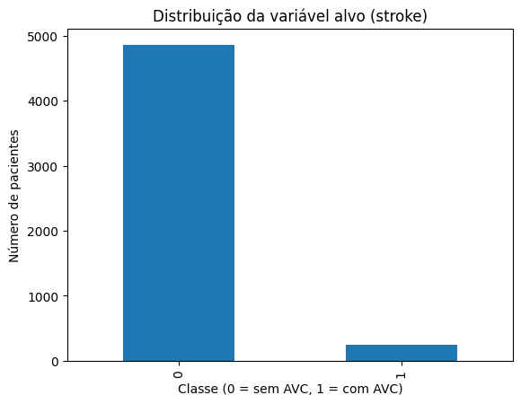

A barra da classe 1 é cerca de 20 vezes menor que a da classe 0 (249 × 4.861). É o desbalanceamento descrito na seção 1.4.

## 2.2 Estatísticas das numéricas

| Variável | Média | Mediana | Desvio padrão |
|---|---|---|---|
| `age` | 43,23 | 45,00 | 22,61 |
| `hypertension` | 0,10 | 0,00 | 0,30 |
| `heart_disease` | 0,05 | 0,00 | 0,23 |
| `avg_glucose_level` | 106,15 | 91,88 | 45,28 |
| `bmi` | 28,89 | 28,10 | 7,85 |
| `stroke` | 0,05 | 0,00 | 0,22 |

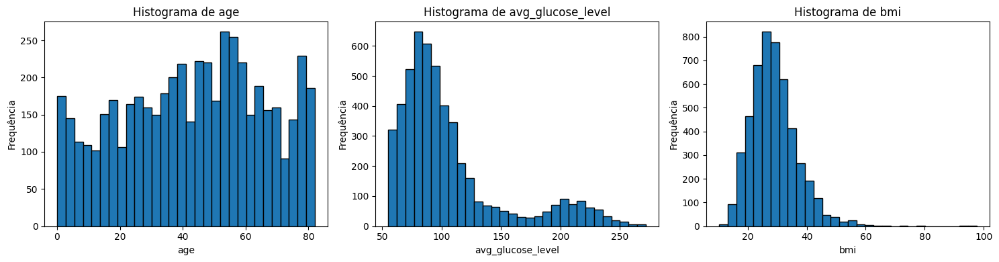
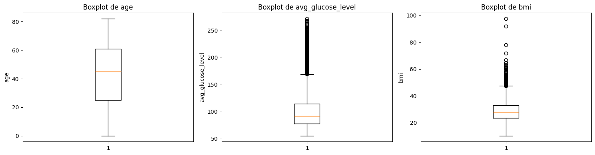

- **`age`:** distribuição larga e aproximadamente uniforme entre 0 e 82 anos. A média (43,2) fica perto da mediana (45).
- **`avg_glucose_level`:** a média (106,2) é bem maior que a mediana (91,9), o que indica **assimetria à direita**. A maioria dos pacientes está entre 60 e 120 mg/dL, e um segundo grupo fica entre 180 e 270 mg/dL, faixa compatível com diabetes. Os boxplots mostram muitos pontos acima do bigode superior. Essa assimetria motivou o `log1p` da mudança no pipeline (seção 7.5).
- **`bmi`:** levemente assimétrico, com dois valores extremos (92 e 97,6).

## 2.3 Categóricas

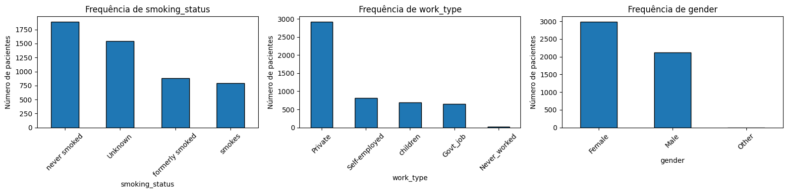

Três categorias são muito pequenas e voltam a aparecer na interpretação dos modelos:
- `gender = Other`: 1 paciente;
- `work_type = Never_worked`: 22 pacientes, **nenhum** com AVC;
- `work_type = children`: 687 pacientes, só 2 com AVC.

## 2.4 Separação treino/teste da APS1

`train_test_split(test_size=0.2, stratify=y, random_state=42)` gerou **4.088 pacientes no treino e 1.022 no teste**, com 4,87% e 4,89% de AVC. O `stratify=y` garante que os dois conjuntos tenham a mesma proporção de AVC. Sem ele, o teste poderia ficar com bem menos de 50 casos por acaso. A análise bivariada a seguir usa **só o treino**, para que nenhuma decisão seja tomada olhando o teste.

## 2.5 Relação com o alvo

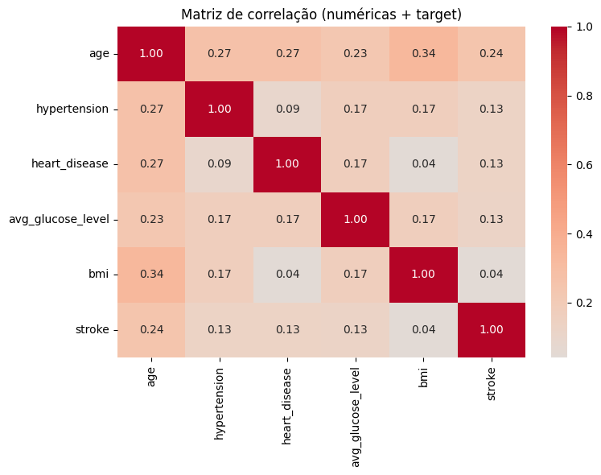

Correlação de cada numérica com `stroke` no treino:

| Variável | Correlação com `stroke` |
|---|---|
| `age` | **0,243** |
| `hypertension` | 0,133 |
| `heart_disease` | 0,127 |
| `avg_glucose_level` | 0,125 |
| `bmi` | 0,044 |

**A idade é de longe o fator mais associado ao AVC.** As médias por grupo, no dataset completo, confirmam isso:

| Grupo | Idade média | Glicose média | `bmi` médio |
|---|---|---|---|
| Sem AVC | 42,0 | 104,8 | 28,8 |
| Com AVC | **67,7** | **132,5** | 30,5 |

Metade dos AVCs ocorreu em pacientes com 71 anos ou mais, e só **8 dos 249** AVCs ocorreram antes dos 40 anos.

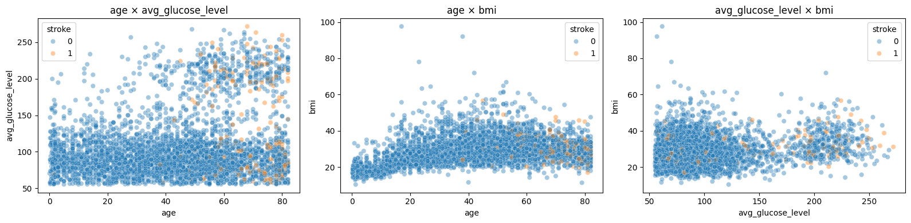
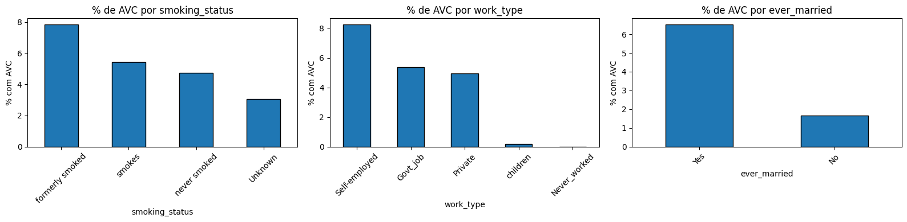

Taxa de AVC por `smoking_status` (treino):

| `smoking_status` | Taxa de AVC |
|---|---|
| formerly smoked | **7,8%** |
| smokes | 5,4% |
| never smoked | 4,7% |
| Unknown | 3,0% |

O grupo de **ex-fumantes** tem a maior taxa, e não o de fumantes atuais. O mais provável é um efeito de idade: ex-fumantes são mais velhos, e pessoas que tiveram um evento de saúde costumam parar de fumar. É um exemplo de **associação que não é causa**. Pelo mesmo motivo, no dataset completo `Self-employed` tem 7,9% de AVC (são trabalhadores mais velhos) e `children` tem 0,3%.

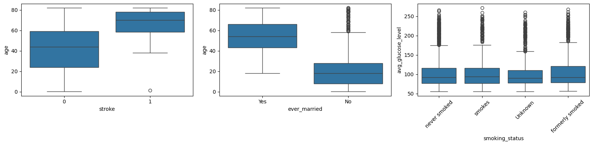

## 2.6 Pré-processamento da APS1

| Etapa | Ferramenta | Justificativa |
|---|---|---|
| Remover `id` | `drop` | É um identificador, sem valor preditivo. Mantê-lo deixaria o modelo decorar pacientes |
| `gender`: `Other` → `Female` | `replace` | Categoria com 1 exemplo (seção 1.3) |
| `bmi` ausente → mediana | `SimpleImputer(strategy="median")` | A mediana é robusta aos valores extremos (92 e 97,6) |
| Numéricas → média 0, dp 1 | `StandardScaler` | Coloca idade (0–82), glicose (55–272) e `bmi` na mesma escala. Isso é necessário para distâncias (K-Means), PCA e modelos lineares |
| Categóricas → colunas 0/1 | `OneHotEncoder(handle_unknown="ignore")` | Modelos numéricos não aceitam texto, e o one-hot não impõe uma ordem que não existe entre as categorias |
| Organização | `ColumnTransformer` | Aplica cada transformação ao seu grupo de colunas |

O resultado foi uma matriz de **5.110 × 20** (5 numéricas + 15 colunas de one-hot).

> **Observação metodológica:** na APS1, o `fit_transform` foi aplicado ao dataset inteiro. Para o clustering (não supervisionado) isso é aceitável, mas em um modelo supervisionado avaliado em teste seria **vazamento de dados**: a mediana e a escala seriam calculadas também com os pacientes de teste. Na APS2, o mesmo pré-processamento foi colocado **dentro de um `Pipeline`**, ajustado só no treino de cada dobra (seção 3.3).

## 2.7 PCA e K-Means

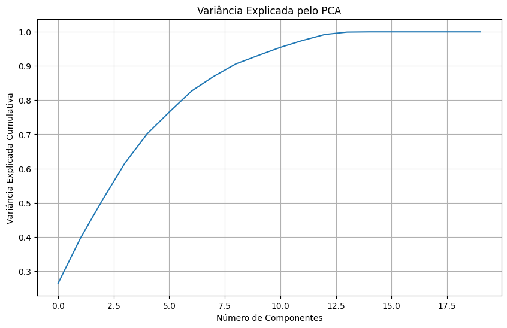

O PCA foi aplicado à matriz pré-processada para estudar a dimensionalidade, com 10 componentes retidos. Os *loadings* dos dois primeiros componentes mostram o que eles representam:
- **CP1:** dominado por `age` (0,58), `bmi` (0,42), `hypertension` (0,36), glicose (0,35) e `heart_disease` (0,29). É um eixo de **idade e risco cardiometabólico**.
- **CP2:** dominado por `heart_disease` (0,72), positivamente, e `bmi` (−0,53), negativamente.

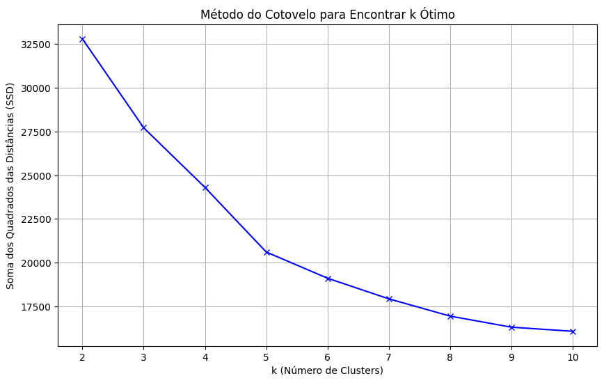
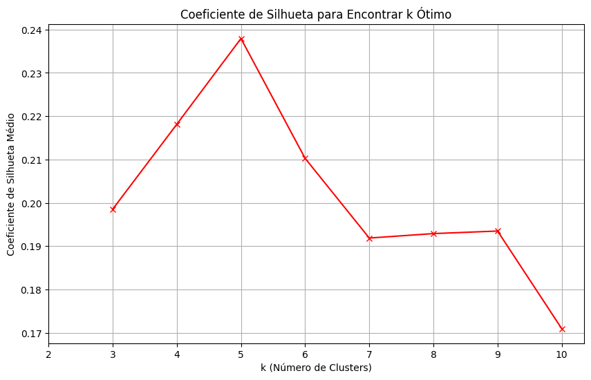

O coeficiente de silhueta teve o máximo em **k = 5 (0,238)**, por isso o K-Means usou 5 clusters. Uma silhueta de 0,24 é baixa: os grupos existem, mas **se sobrepõem bastante**, o que é esperado em dados de pacientes sem segmentos naturais bem definidos.

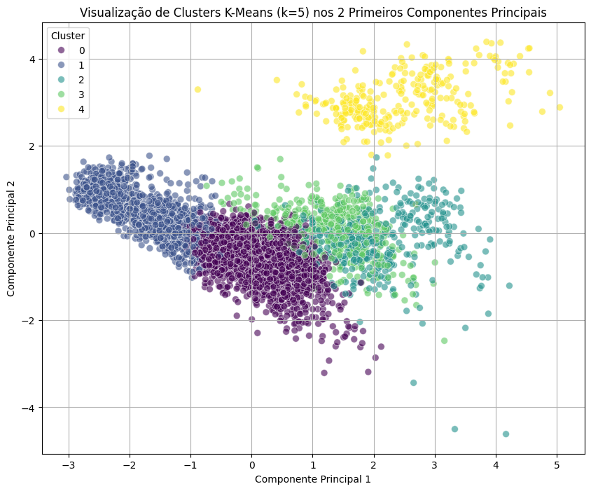
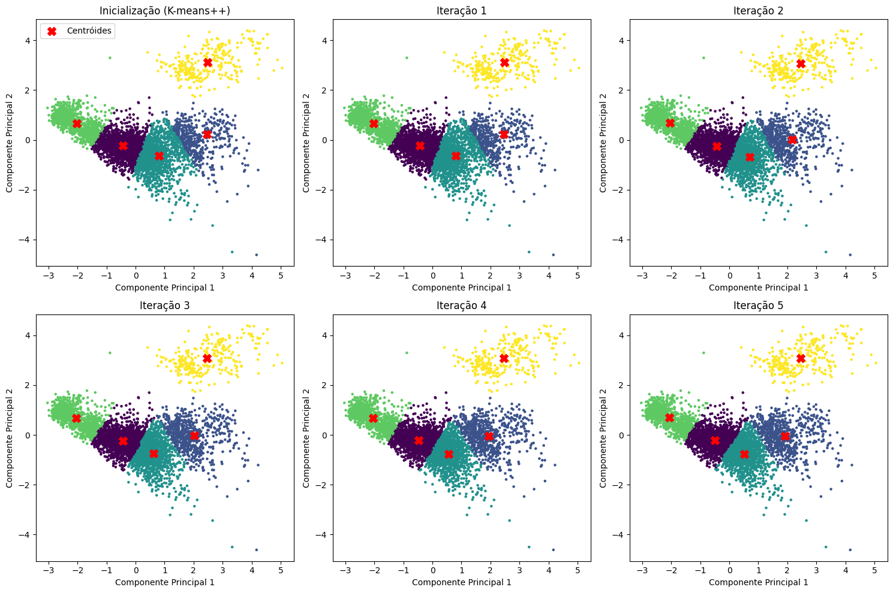
