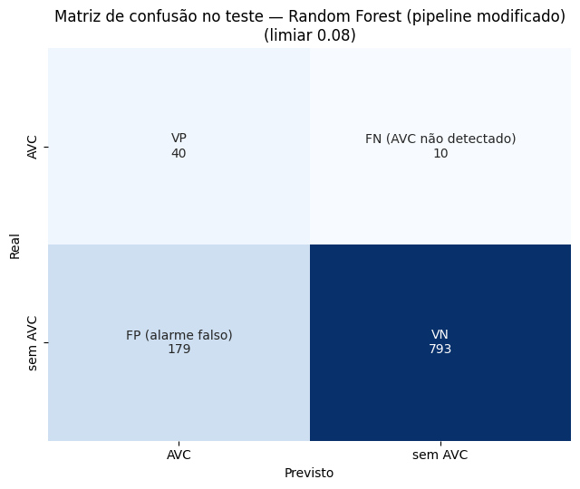
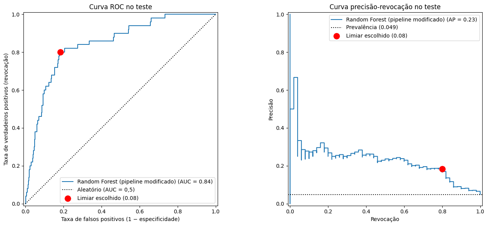

# 8. APS2 — Avaliação do melhor modelo no teste

## 8.1 Escolha do limiar

A Random Forest prevê probabilidades. As métricas pedidas (accuracy, precision, recall e F1) precisam de um corte. O limiar foi escolhido **só com o treino**: probabilidades fora da dobra e o valor que **maximiza o F2** (seção 6.3). **Limiar escolhido: 0,08.**

## 8.2 Métricas no teste

| Limiar | Accuracy | Precision | Recall | F1-score | F2 |
|---|---|---|---|---|---|
| **0,08 (F2)** | 0,8151 | **0,1826** | **0,8000** | **0,2974** | **0,4773** |
| 0,50 (padrão) | 0,9511 | 0,0000 | 0,0000 | 0,0000 | 0,0000 |

| Métrica independente de limiar | Valor |
|---|---|
| **ROC-AUC** | **0,8442** |
| Average precision | 0,2302 (prevalência 0,0489 → **4,7 vezes** o acaso) |

**Leitura das métricas:**
- **Recall 0,80:** o modelo encontra 4 de cada 5 AVCs. É a métrica priorizada pela premissa de custo.
- **Precision 0,18:** cerca de 1 em cada 5,5 alertas é um AVC real. Parece baixo, mas a taxa de base é 1 em 20, então um alerta do modelo tem **3,7 vezes** mais chance de ser AVC que um paciente qualquer.
- **Accuracy 0,815:** mais baixa que a do limiar 0,5 (0,951), que não detecta **nenhum** AVC. É o paradoxo da acurácia de novo: o limiar padrão daria a maior acurácia e o modelo inútil.
- **F1 0,30:** é baixo porque o F1 pesa precisão e revocação igualmente, e a precisão é limitada pela prevalência.
- **AP no teste (0,230) × validação (0,263):** a diferença está dentro do desvio entre dobras (±0,06) e é coerente com o leve otimismo de escolher o melhor entre vários modelos na validação.

## 8.3 Matriz de confusão

|  | Previsto AVC | Previsto sem AVC |
|---|---|---|
| **Real AVC** | **VP = 40** | **FN = 10** (AVCs não detectados) |
| **Real sem AVC** | **FP = 179** (alarmes falsos) | VN = 793 |

- **Falsos negativos (10):** são os erros mais graves. Esses pacientes tiveram AVC e não seriam sinalizados. Na seção 9.3, o SHAP mostra que o FN mais extremo é uma criança de 14 anos sem comorbidades, um perfil que as variáveis disponíveis não conseguem identificar.
- **Falsos positivos (179):** 18% dos pacientes sem AVC seriam sinalizados. É o custo de buscar recall alto numa classe rara. Em triagem, isso significaria encaminhar esses pacientes para avaliação preventiva.
- **Comparação com a logística no teste (seção 6.5):** a RF encontrou 40 AVCs com 179 alarmes falsos; a logística, 39 com 188. **No teste, a vantagem da RF é pequena**, coerente com a diferença modesta na validação.

## 8.4 Curva ROC e curva precisão-revocação

- **ROC-AUC = 0,844:** sorteando ao acaso um paciente com AVC e outro sem, o modelo dá risco maior ao paciente com AVC em 84% das vezes. A diagonal pontilhada (0,5) é o acaso. O ponto vermelho é o limiar 0,08 (taxa de falsos positivos 0,18, revocação 0,80).
- **Curva precisão-revocação:** fica bem abaixo da ROC, e a linha da prevalência (0,049) é a referência de acaso. Ela mostra o custo real da classe rara: para passar de 80% de revocação, a precisão cai para perto da prevalência. A ROC sozinha, com 0,84, daria uma impressão otimista demais. Esse é o motivo de a AP ter sido a métrica de seleção.
