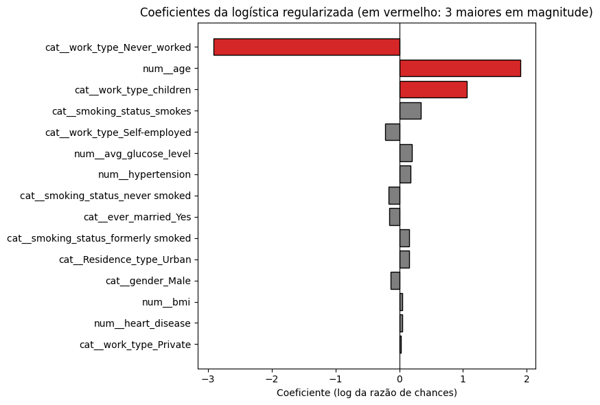
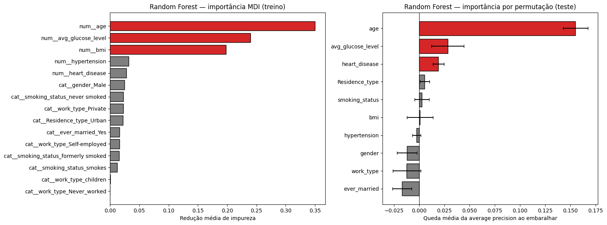
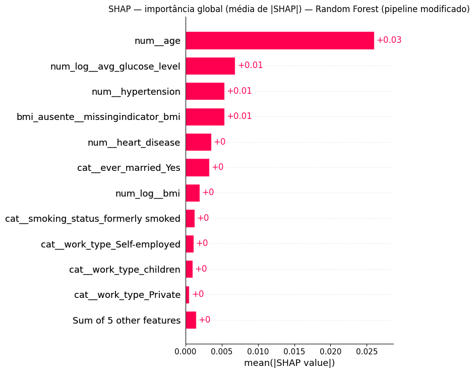
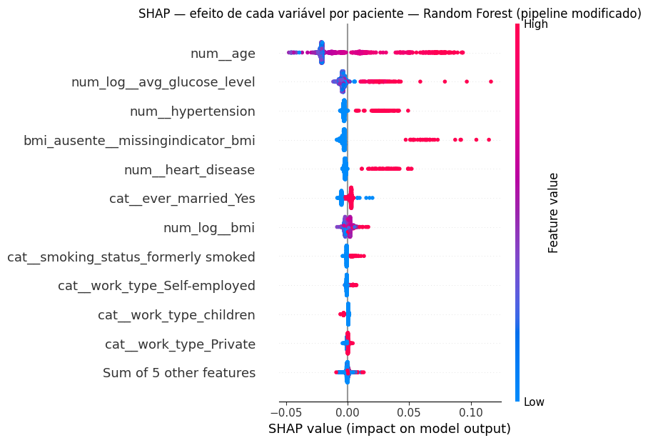
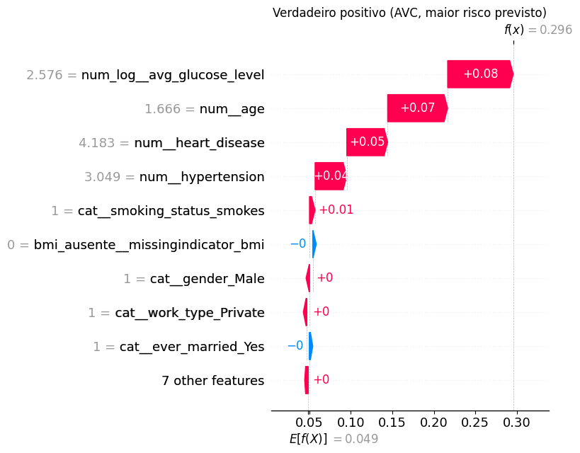
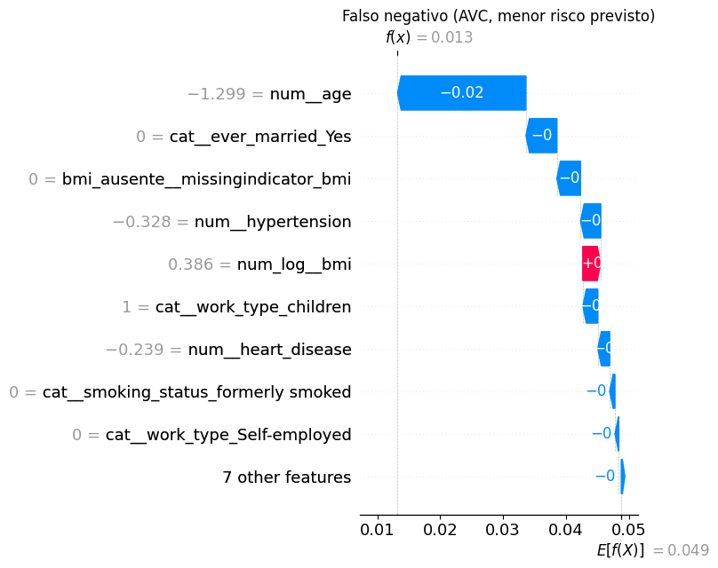
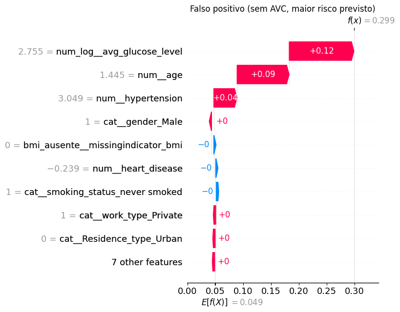

# 9. APS2 — Interpretação e explicabilidade

## 9.1 Modelo linear: 3 coeficientes de maior magnitude

Modelo: a melhor logística do `GridSearchCV` (`C = 100`, L1, `balanced`). As numéricas estão padronizadas, então os coeficientes são comparáveis entre si.

| # | Variável | Coeficiente | Razão de chances | Leitura |
|---|---|---|---|---|
| 1 | `work_type_Never_worked` | −2,920 | ×0,05 | "Nunca ter trabalhado" reduziria a chance em 95% |
| 2 | `age` (+1 dp ≈ 22,6 anos) | +1,898 | ×6,67 | 22,6 anos a mais multiplicam a chance por 6,7 |
| 3 | `work_type_children` | +1,061 | ×2,89 | Ser "criança" quase triplicaria a chance |

**Análise:** só a **idade** tem uma interpretação válida. As outras duas são **artefatos estatísticos**:
- **`Never_worked`:** são 22 pacientes e **nenhum AVC** (seção 5.3). Sem nenhum evento, o coeficiente que maximiza a verossimilhança tende a −∞. Com `C = 100`, quase não há penalidade para segurá-lo. O valor −2,92 reflete o tamanho da categoria e a regularização fraca, **não um efeito protetor**.
- **`children`:** crianças têm só 0,3% de AVC (2 em 687). O coeficiente positivo aparece porque a idade já está no modelo: entre crianças, idade e `work_type` estão totalmente sobrepostas, e o coeficiente só corrige a previsão da idade para essa faixa. Ele é instável (baseado em 2 casos) e não significa que ser criança aumente o risco.
- **`age`:** é o efeito dominante e coerente com a literatura (a incidência de AVC cresce com a idade) e com a EDA (idade média de 67,7 anos nos casos contra 42,0).

**Lição:** os coeficientes de maior magnitude não são necessariamente as variáveis mais importantes. Com `C` menor (mais regularização), os coeficientes das categorias raras seriam encolhidos, e as variáveis clínicas (glicose, hipertensão) subiriam no ranking, sem perda de AP (seção 7.3).

## 9.2 Modelo ensemble: 3 features mais importantes

Modelo: a melhor Random Forest da seção 7.4 (pipeline da APS1). Foram usadas duas medidas.

| # | MDI (impureza, no treino) | Permutação (queda da AP, no teste) |
|---|---|---|
| 1 | `age` | `age` |
| 2 | `avg_glucose_level` | `avg_glucose_level` |
| 3 | `bmi` | `heart_disease` |

**Análise:**
- **`age` e `avg_glucose_level` lideram nas duas medidas.** São as importâncias robustas, coerentes com a correlação (seção 2.5) e com fatores de risco clínicos conhecidos: o envelhecimento e a hiperglicemia, ligada ao diabetes, são fatores de risco estabelecidos para AVC.
- **O `bmi` aparece em 3º na MDI, mas sai do top 3 na permutação.** A MDI é calculada no treino e **favorece variáveis contínuas com muitos valores distintos** (418 no `bmi`), porque elas oferecem muitos pontos de corte e a árvore os usa para decorar. A permutação, medida em dados novos, mostra que embaralhar o `bmi` quase não piora a AP. O ganho dele era memorização. Isso é coerente com a correlação fraca do `bmi` com o AVC (0,044).
- **`heart_disease`** entra no top 3 da permutação. É binária, então a MDI a subestima (só oferece uma divisão possível), mas ela carrega sinal real.
- A importância mostra **quanto** o modelo depende de cada variável, não **em que direção**. A direção aparece no SHAP.

## 9.3 SHAP no melhor modelo

Modelo: Random Forest com o pipeline modificado. Com o `TreeExplainer`, os valores ficam em **unidades de probabilidade**: a previsão de cada paciente é igual ao valor base (a probabilidade média) mais a soma das contribuições de cada variável (Lundberg & Lee, 2017).

### Importância global

Ordem de importância (média de |SHAP|): **`age` > `avg_glucose_level` > `hypertension` > `bmi` ausente > `heart_disease`** > `ever_married` > `bmi` > ex-fumante > …

Leitura do beeswarm, em que cada ponto é um paciente, a cor é o valor da variável (vermelho = alto) e a posição é o efeito no risco:
- **`age`:** idades altas (vermelho) empurram o risco para cima em até +0,09; idades baixas (azul) reduzem levemente. É a relação monotônica esperada, e é também a variável com maior espalhamento.
- **Glicose (log):** a maioria dos pacientes tem efeito ≈ 0, mas glicose alta acrescenta até +0,12, o maior efeito individual do gráfico. O efeito é **não linear**: só os valores altos importam, o que a Random Forest captura sem precisar de termos polinomiais.
- **`hypertension` e `heart_disease`:** quando presentes (vermelho), somam entre +0,02 e +0,05. Quando ausentes, quase não mudam nada.
- **Indicador de `bmi` ausente:** quando o `bmi` falta (vermelho), o risco sobe entre +0,05 e +0,11. É a variável criada na seção 7.6, e o tamanho do efeito reforça a ressalva feita lá.
- **`ever_married`:** efeito pequeno, provavelmente herdado da idade, já que pessoas casadas são em média mais velhas.

### Três predições individuais

Escolhemos três pacientes do teste que representam situações diferentes: o acerto mais confiante, o erro mais grave e o alarme falso mais forte.

**Caso 1 — Verdadeiro positivo (o paciente com AVC de maior risco previsto)**

| Perfil | Valor |
|---|---|
| Sexo / idade | Masculino, **81 anos** |
| Hipertensão / doença cardíaca | **Sim / Sim** |
| Glicose média | **250,9 mg/dL** |
| `bmi` / tabagismo | 28,1 / fumante |
| **Probabilidade prevista** | **0,296** (6 vezes a taxa de base) |

Features que mais contribuíram: **glicose (+0,079), idade (+0,072), doença cardíaca (+0,049)**. É o perfil clássico de alto risco, com todos os fatores somando na mesma direção. Mesmo assim, a probabilidade fica em 0,30, e não perto de 1. As variáveis disponíveis não bastam para ter certeza de um AVC.

**Caso 2 — Falso negativo (o paciente com AVC de menor risco previsto)**

| Perfil | Valor |
|---|---|
| Sexo / idade | Feminino, **14 anos** |
| Hipertensão / doença cardíaca | Não / Não |
| Glicose média | 57,9 mg/dL (normal) |
| `bmi` / tabagismo | 30,9 / Unknown |
| Tipo de trabalho | children |
| **Probabilidade prevista** | **0,013** |

Features que mais contribuíram: **idade (−0,020), `ever_married = Yes` ausente (−0,005), `bmi` registrado (−0,004)**, todas **reduzindo** o risco. Esse é o **erro mais grave** do modelo: uma adolescente sem nenhum fator de risco registrado. AVCs em jovens costumam ter causas que **não estão no dataset**, como malformações vasculares, doenças cardíacas congênitas ou distúrbios de coagulação. Nenhum modelo treinado com essas variáveis conseguiria sinalizá-la. É uma limitação dos **dados**, não do algoritmo. Ela é um dos 8 AVCs com menos de 40 anos no dataset (3%).

**Caso 3 — Falso positivo (o paciente sem AVC de maior risco previsto)**

| Perfil | Valor |
|---|---|
| Sexo / idade | Masculino, **76 anos** |
| Hipertensão / doença cardíaca | **Sim** / Não |
| Glicose média | **267,6 mg/dL** |
| `bmi` / tabagismo | 30,5 / nunca fumou |
| **Probabilidade prevista** | **0,299** |

Features que mais contribuíram: **glicose (+0,116), idade (+0,094), hipertensão (+0,042)**. O perfil é quase idêntico ao do Caso 1, e a probabilidade também (0,299 × 0,296). **Para o modelo, os dois pacientes são indistinguíveis.** Esse "erro" faz sentido: é um paciente de altíssimo risco que não teve AVC **no período registrado**. Clinicamente, é exatamente o tipo de paciente que um sistema de triagem deveria sinalizar para acompanhamento preventivo.
