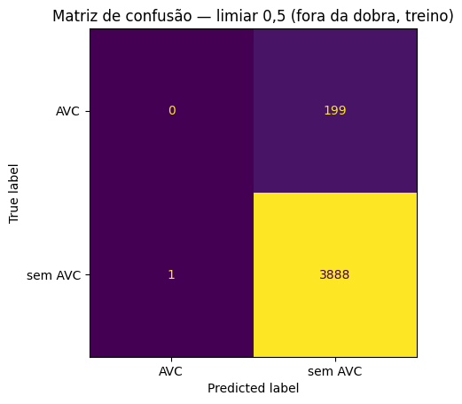
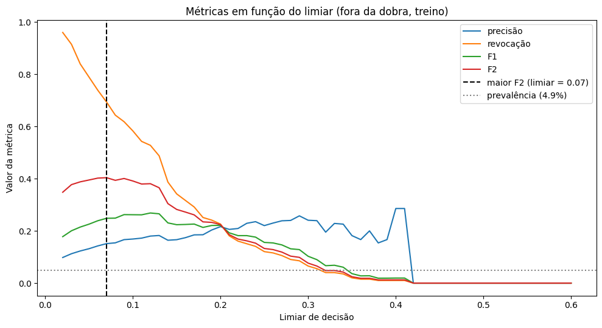
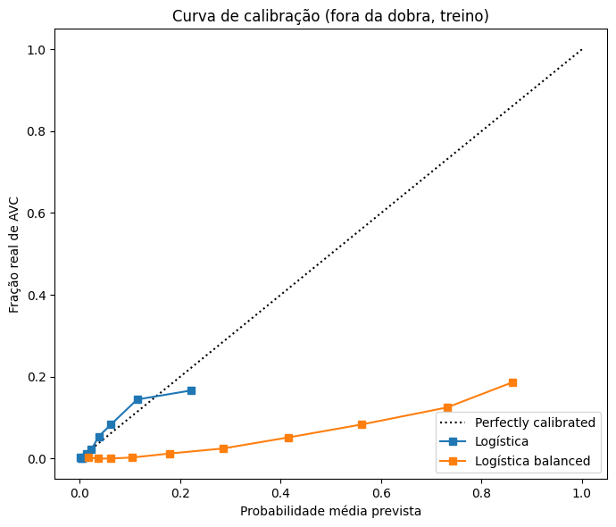
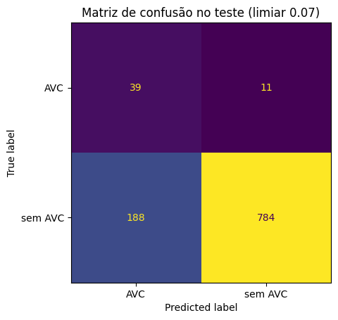

# 6. Métricas de classificação

**Premissa de custo:** num problema de saúde, **deixar de detectar um AVC (falso negativo) custa mais caro** que um alarme falso (falso positivo), que só leva a exames adicionais. Essa assimetria guia todas as escolhas abaixo.

## 6.1 Matriz de confusão e o paradoxo da acurácia

A matriz é montada com `labels=[1, 0]`, para o AVC (positivo) aparecer primeiro. Com o limiar 0,5 (fora da dobra): **TP = 0, FN = 199, FP = 1, TN = 3.888**.

Conferência das métricas à mão, com limiar 0,2 (TP 45, FN 154, FP 163, TN 3.726). Os valores calculados à mão e pelo scikit-learn foram idênticos:

| Métrica | Fórmula | Valor |
|---|---|---|
| Acurácia | (TP+TN)/total | 0,9225 |
| Precisão | TP/(TP+FP) | 0,2163 |
| Revocação | TP/(TP+FN) | 0,2261 |
| Especificidade | TN/(TN+FP) | 0,9581 |
| F1 | 2TP/(2TP+FP+FN) | 0,2211 |

## 6.2 Comparação com baselines

| Modelo | Acurácia | Precisão | Revocação | F1 | F2 | Acur. balanceada | MCC |
|---|---|---|---|---|---|---|---|
| Dummy (sempre sem AVC) | **0,951** | 0,000 | 0,000 | 0,000 | 0,000 | 0,500 | 0,000 |
| Dummy (estratificado) | 0,895 | 0,058 | 0,075 | 0,065 | 0,071 | 0,506 | 0,011 |
| Logística, limiar 0,5 | **0,951** | 0,000 | 0,000 | 0,000 | 0,000 | 0,500 | −0,004 |
| Logística, limiar 0,1 | 0,840 | 0,169 | **0,583** | 0,262 | 0,391 | **0,718** | **0,251** |

**Paradoxo da acurácia:** o Dummy que nunca prevê AVC tem a **maior acurácia** da tabela. A acurácia balanceada (média entre revocação e especificidade) e o MCC (correlação entre o previsto e o real; Chicco & Jurman, 2020) não se deixam enganar: os dois dão zero de ganho para o Dummy e mostram a vantagem real da logística com limiar baixo.

## 6.3 Escolha do limiar pelo F2

O **F2** é um F-beta com β = 2, que dá à revocação quatro vezes o peso da precisão. Ele traduz a premissa de custo.

O limiar que maximiza o F2 fora da dobra foi **0,07**, com precisão 0,151, revocação 0,693, F1 0,248 e F2 0,404. O `class_weight="balanced"`, que muda os pesos das classes no treino em vez de mudar o corte, chegou a um equilíbrio parecido (revocação 0,789, F2 0,397, MCC 0,250). Mudar o limiar e reponderar as classes são duas formas equivalentes de trocar alarmes falsos por AVCs encontrados.

**Por que a precisão é sempre baixa:** com 5% de prevalência, mesmo um bom modelo gera muitos alarmes falsos para cada AVC encontrado. A precisão deve sempre ser lida **junto com a prevalência**: 0,15 de precisão significa que um alerta tem 3 vezes a taxa de base (0,049).

## 6.4 Qualidade das probabilidades

| Modelo | Log loss | Brier |
|---|---|---|
| Dummy (prevalência) | 0,1946 | 0,0463 |
| Logística | **0,1582** | **0,0429** |
| Logística `balanced` | 0,5126 | 0,1726 |

A logística comum está **bem calibrada** nas probabilidades baixas, onde fica a maioria dos pacientes: entre os que receberam ~10%, cerca de 10–15% tiveram AVC. A versão `balanced` **infla as probabilidades**: pacientes com 0,86 de "probabilidade" prevista têm só ~19% de AVC real. Por isso o `class_weight="balanced"` serve para classificar, mas suas probabilidades não podem ser lidas como risco.

## 6.5 Logística no teste (referência)

Com o limiar 0,07: **TP = 39, FN = 11, FP = 188, TN = 784.** Acurácia 0,805, precisão 0,172, revocação 0,780, F1 0,282, MCC 0,304. Esse resultado serve só de referência para o melhor modelo da seção 8.

