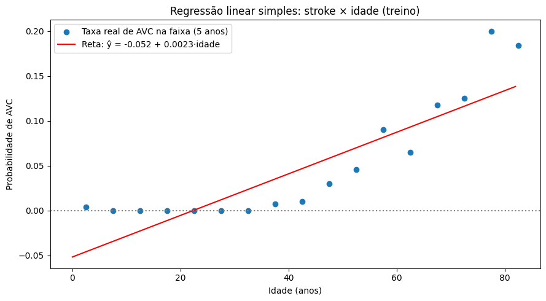
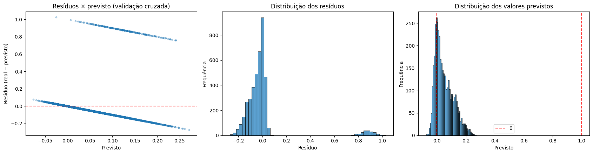
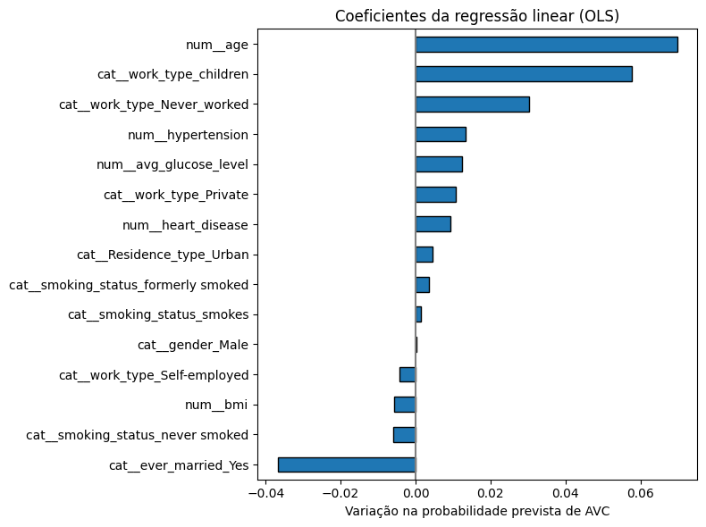
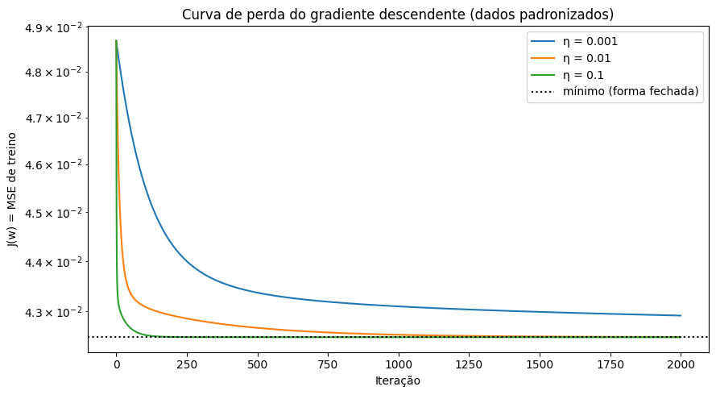
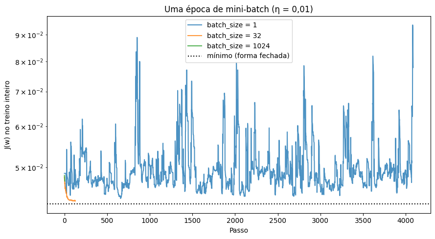
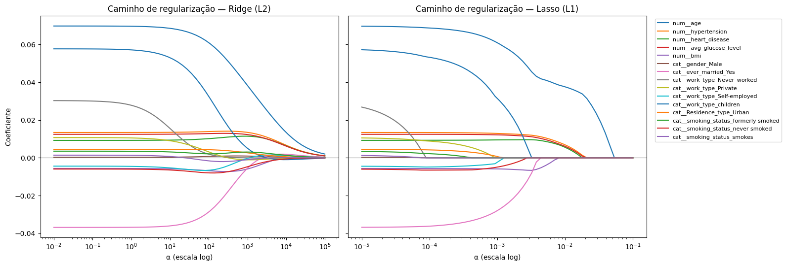
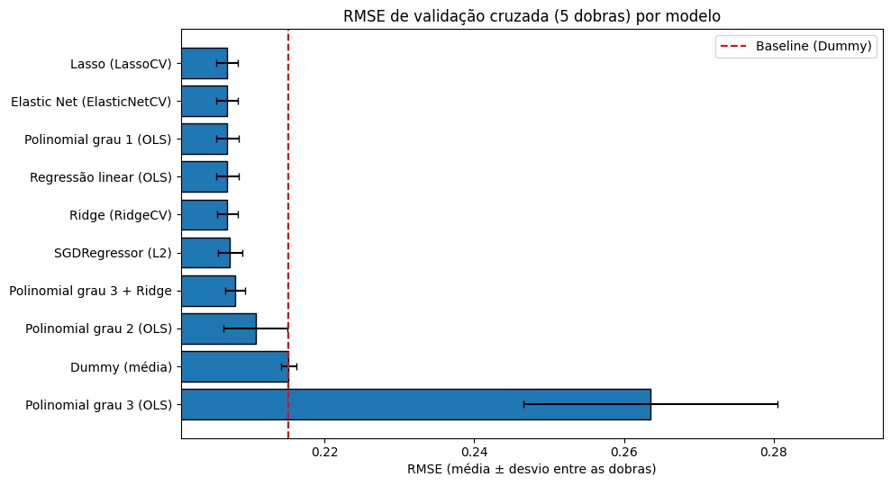

# 4. Regressão linear sobre o `stroke` (estudo exploratório)

Antes da classificação, o notebook estuda o que acontece ao tratar `stroke` (0/1) com **regressão linear**. Essa abordagem se chama **modelo de probabilidade linear**: o valor previsto seria a chance de AVC. O objetivo é mostrar, com os próprios dados, por que esse caminho falha e por que a regressão logística é a escolha correta.

## 4.1 Regressão simples feita à mão: `stroke` × `age`

As equações normais (XᵀX w = Xᵀy) foram resolvidas com `np.linalg.solve`, que resolve o sistema diretamente, sem inverter a matriz.

| Resultado | Valor |
|---|---|
| w₀ (intercepto) | −0,05183 |
| w₁ (idade) | 0,00232 |
| Conferência: r · s_y / s_x | 0,00232 (r = 0,2434) ✔ |
| Σe (soma dos resíduos) | −1,8 × 10⁻¹⁴ ≈ 0 ✔ |
| Σe·x | 2,9 × 10⁻¹² ≈ 0 ✔ |

As duas somas nulas confirmam as propriedades da solução de mínimos quadrados: os resíduos têm média zero e são ortogonais à variável explicativa.

**Interpretação:** cada ano a mais soma 0,23 ponto percentual à "probabilidade" prevista. A reta, no entanto, **fica negativa abaixo de ~22 anos** (−0,0518 + 0,00232 · idade < 0), e a taxa real de AVC cresce de forma **curva**: quase zero até os 40 anos, acelerando depois. Uma reta não reproduz essa forma.

## 4.2 Regressão linear múltipla

Validação cruzada em 5 dobras:

| Modelo | RMSE validação | MAE validação | R² validação |
|---|---|---|---|
| Dummy (média) | 0,2152 | 0,0926 | 0,000 |
| Regressão linear (OLS) | **0,2070** | 0,0941 | **0,0745** |

O OLS explica só **7,5% da variância**. Isso é esperado num alvo 0/1 raro: a maior parte da variação é individual e não está nas variáveis. O MAE do OLS chega a ficar pior que o do Dummy. Prever sempre ~0,05 erra pouco na maioria dos pacientes, que não tiveram AVC.

O gráfico de resíduos mostra três problemas:
1. **Duas faixas diagonais:** como y só vale 0 ou 1, o resíduo é sempre −ŷ ou 1 − ŷ. Os resíduos não podem ter distribuição normal.
2. **Heteroscedasticidade:** a variância de um alvo binário é p(1−p), que muda com p. O espalhamento dos resíduos varia ao longo do eixo.
3. **25,4% das previsões são negativas:** uma "probabilidade" negativa não tem sentido.

## 4.3 Gradiente descendente

O mesmo problema foi resolvido pelo gradiente descendente, w ← w − η·∇J, com ∇J = −(2/n)Xᵀ(y − Xw). A referência é a forma fechada (RMSE de treino 0,20612).

| η | RMSE após 2.000 iterações | Maior distância aos pesos ótimos |
|---|---|---|
| 0,001 | 0,20715 | 0,046 |
| 0,01 | 0,20613 | 0,028 |
| 0,1 | **0,20612** | 0,009 |

Com η = 0,1, o gradiente descendente chega praticamente à mesma solução da forma fechada. Com η menor, ele ainda não convergiu em 2.000 iterações.

**Por que padronizar.** O gradiente descendente só converge se η < 2/λ_max, onde λ_max é o maior autovalor de (2/n)XᵀX (a curvatura máxima da função de perda):

| Dados | λ_max | Limite de η | Razão λ_max/λ_min |
|---|---|---|---|
| Crus (idade, glicose, `bmi`) | 31.901,7 | 6,3 × 10⁻⁵ | 289.580 |
| Padronizados | 2,97 | 0,673 | 2 |

Com os dados crus, η = 0,01 está 160 vezes acima do limite. A perda **explode** de 0,049 para 3,7 × 10⁴² em 10 iterações. Com os dados padronizados, o mesmo η converge suavemente. A glicose, com valores na casa das centenas, cria uma curvatura enorme numa direção. **Esse é o motivo de o `StandardScaler` vir antes de qualquer modelo treinado por gradiente ou com penalidade.**

**Mini-batch** (uma época, η = 0,01):

| batch_size | Passos | RMSE final |
|---|---|---|
| 1 | 4.088 | 0,279 (instável) |
| 32 | 128 | **0,2075** |
| 1.024 | 4 | 0,2169 (poucos passos) |

Com lote 32, o mini-batch chega perto do ótimo numa única passada pelos dados. Com lote 1, o ruído de cada passo atrapalha. Com lote 1.024, são só 4 passos, e o modelo não chega lá. O `SGDRegressor` do scikit-learn ficou com RMSE de validação 0,2074, praticamente igual ao OLS.

## 4.4 Atributos polinomiais: subajuste × sobreajuste

| Grau | Nº de colunas | RMSE treino | RMSE validação | Desvio entre dobras | R² validação |
|---|---|---|---|---|---|
| 1 | 15 | 0,2060 | **0,2070** | 0,0015 | **0,075** |
| 2 | 135 | 0,2005 | 0,2108 | 0,0042 | 0,041 |
| 3 | 815 | 0,1840 | 0,2635 | **0,0170** | **−0,507** |

No grau 3, o erro de treino cai, mas o de validação sobe e o desvio entre dobras fica 11 vezes maior. É **sobreajuste**: o modelo erra de forma imprevisível em dados novos, e o R² negativo indica que ele fica pior que prever a média.

## 4.5 Regularização: Ridge, Lasso e Elastic Net

- No **Ridge**, conforme α cresce, todos os coeficientes encolhem juntos, mas nenhum chega a zero.
- No **Lasso**, os coeficientes **vão sendo zerados** um a um: com α = 0,0001 restam 13 de 15; com 0,001, 10; com 0,005, 5; com 0,01, só 4. As que sobrevivem por último são as mais informativas.

O α foi escolhido por validação cruzada (`RidgeCV`, `LassoCV`, `ElasticNetCV`), nunca pelo erro de treino, que sempre prefere α = 0:

| Modelo | α escolhido | Coeficientes não nulos | RMSE validação |
|---|---|---|---|
| Ridge | 37,28 | 15/15 | 0,2070 |
| Lasso | 0,00040 | 12/15 | 0,2070 |
| Elastic Net (l1_ratio = 0,9) | 0,00044 | 12/15 | 0,2070 |
| Polinomial grau 3 + Ridge | — | 815 | 0,2081 |

**Interpretação:**
- Com apenas 15 colunas e 4 mil pacientes, quase não há sobreajuste para corrigir, então a regularização não muda o desempenho. Ela só simplifica o modelo: o Lasso dispensa 3 variáveis sem perda.
- No polinomial de grau 3, o Ridge faz a diferença: o RMSE de validação cai de 0,2635 para 0,2081.

**Teste** (avaliado uma vez):

| Modelo | RMSE teste | R² teste |
|---|---|---|
| Dummy | 0,2157 | 0,000 |
| OLS | 0,2056 | 0,091 |
| Ridge / Lasso / Elastic Net | 0,2057 | 0,090 |
| Polinomial grau 3 + Ridge | **0,2054** | **0,093** |

**Conclusão da seção:** a regressão linear até supera o baseline, mas viola as premissas do modelo (resíduos em faixas, variância não constante, previsões negativas). **O problema é de classificação** e é tratado como tal a partir daqui.
