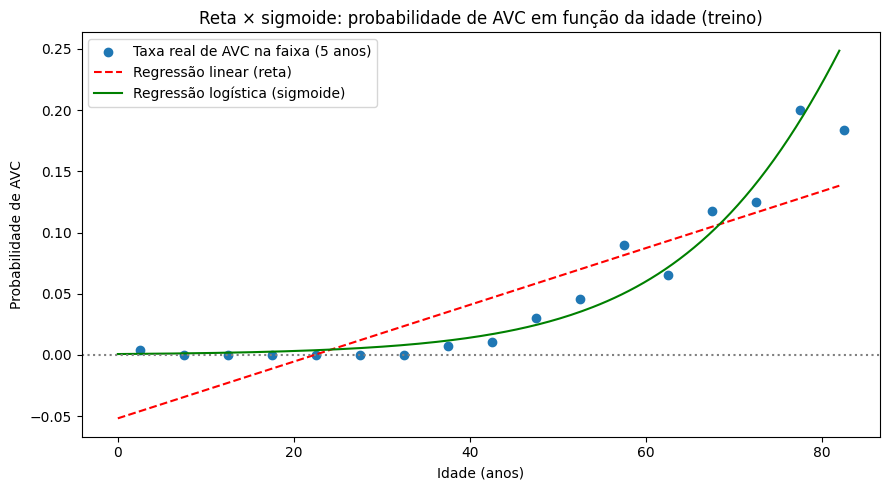
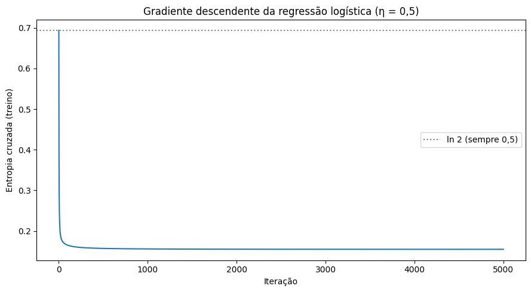
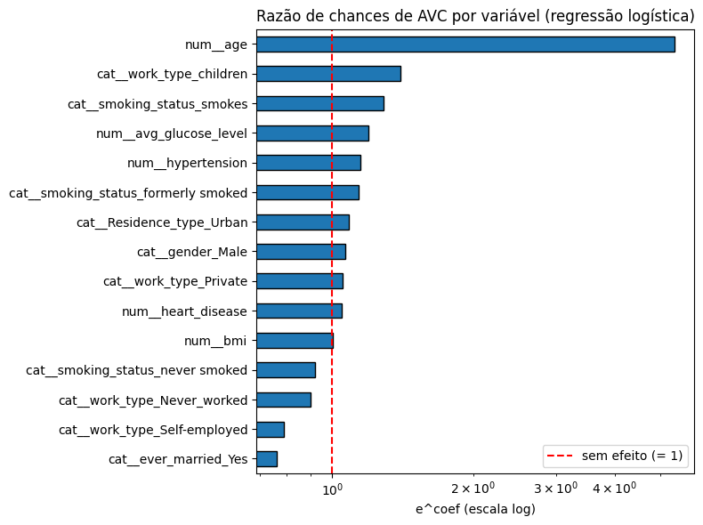

# 5. Regressão logística

## 5.1 Reta × sigmoide

A regressão logística passa o escore linear z = wᵀx + b pela sigmoide, σ(z) = 1/(1 + e⁻ᶻ). Com isso, a saída fica sempre entre 0 e 1.

Com só a idade (sem penalidade): **w = 0,0748, b = −7,241**. A sigmoide acompanha a forma curva da taxa real: quase zero nos jovens e acelerando após os 50 anos, justamente o que a reta da seção 4.1 não conseguia.

| Idade | z | Probabilidade de AVC | `predict` |
|---|---|---|---|
| 30 | −4,997 | 0,67% | 0 |
| 60 | −2,752 | 6,0% | 0 |
| 80 | −1,256 | **22,2%** | 0 |

O `predict_proba` coincide exatamente com σ(`decision_function`). Mesmo aos 80 anos a probabilidade fica abaixo de 0,5, então o `predict` (corte em 0,5) devolve 0 para todos. **Com ~5% de prevalência, o limiar padrão quase nunca é atingido** (seção 5.5).

## 5.2 Chances (odds)

- **e^w = 1,0777:** cada ano a mais de idade multiplica a chance de AVC por **1,078** (+7,8%).
- **A cada 10 anos**, a chance é multiplicada por **2,11**.
- A razão entre as chances de idades vizinhas (50 → 51 → 52) é constante (1,0777), o que confirma que o efeito é multiplicativo na escala da chance.

## 5.3 Entropia cruzada e gradiente

| Modelo | Entropia cruzada (log loss) |
|---|---|
| Sempre 0,5 | 0,6931 (= ln 2) |
| Sempre a prevalência | 0,1946 |
| Logística só com a idade | **0,1584** |

O cálculo à mão e o `log_loss` do scikit-learn dão o mesmo valor (0,1584). A idade sozinha já reduz a perda em 19% em relação a prever sempre a prevalência.

O gradiente descendente com todas as variáveis (∇J = (1/n)Xᵀ(p̂ − y), η = 0,5, 5.000 iterações) parte de 0,6931 e chega a **0,1551**, a mesma perda do scikit-learn. Mesmo assim, os pesos diferem em até 0,69. O motivo é a categoria **`Never_worked`: 22 pacientes, nenhum com AVC**. Para essa coluna, a perda continua diminuindo enquanto o coeficiente vai para −∞, uma **separação quase completa**. Cada otimizador para num ponto diferente dessa direção sem fundo, e a perda quase não muda. É um primeiro sinal de que essa categoria vai distorcer os coeficientes (seção 9.1).

## 5.4 Coeficientes como razões de chances

Logística com todas as variáveis, sem penalidade:

| Variável | Razão de chances |
|---|---|
| `age` (+1 dp ≈ 22,6 anos) | **5,36** |
| `work_type_children` | 1,40 |
| `smoking_status_smokes` | 1,28 |
| `avg_glucose_level` (+1 dp) | 1,19 |
| `hypertension` (+1 dp) | 1,15 |
| … | … |
| `ever_married_Yes` | 0,76 |

Mantendo as outras variáveis fixas, 22,6 anos a mais multiplicam a chance de AVC por 5,4. A razão de chances de `children` (1,40) contradiz a intuição: não significa que crianças tenham mais AVC. Como a idade já está no modelo, esse coeficiente só **corrige** a previsão da idade para esse grupo, e é instável porque há só 2 AVCs entre 687 crianças.

## 5.5 Limiar de decisão

Probabilidades **fora da dobra** no treino, em que cada paciente é previsto por um modelo que não o viu:

| Limiar | AVCs previstos | AVCs perdidos (de 199) | Alarmes falsos | Acurácia |
|---|---|---|---|---|
| 0,5 | 1 | **199** | 1 | 0,951 |
| 0,3 | 54 | 186 | 41 | 0,944 |
| 0,2 | 208 | 154 | 163 | 0,922 |
| 0,1 | 687 | 83 | 571 | 0,840 |
| 0,05 | 1.192 | 42 | 1.035 | 0,737 |

Com o limiar 0,5, o modelo **não detecta nenhum AVC** e ainda assim tem 95,1% de acurácia. Baixar o limiar troca alarmes falsos por AVCs encontrados. **A acurácia não mostra essa troca**, o que motiva as métricas da seção 6.

## 5.6 Termos polinomiais na logística

| Modelo | Log loss treino | Log loss validação |
|---|---|---|
| Grau 1 | 0,1547 | **0,1582 ± 0,0030** |
| Grau 2 | 0,1367 | 0,1849 ± 0,0153 |

O grau 2 sobreajusta: o treino melhora, a validação piora e fica 5 vezes mais instável. **O modelo linear (grau 1) foi mantido.**
