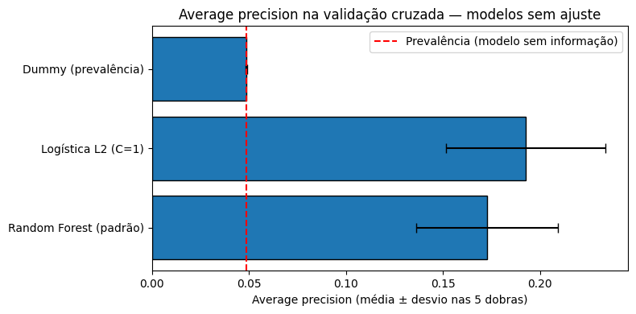
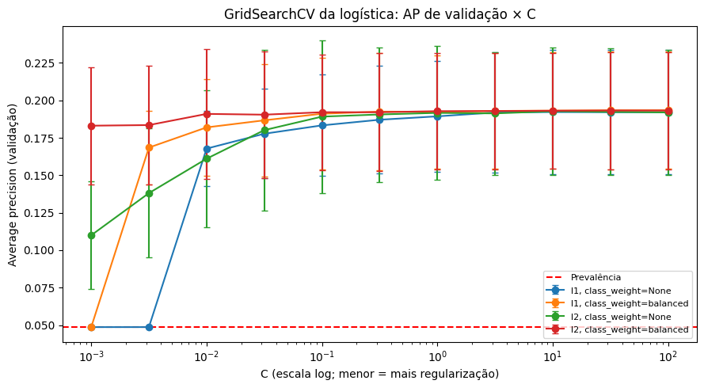
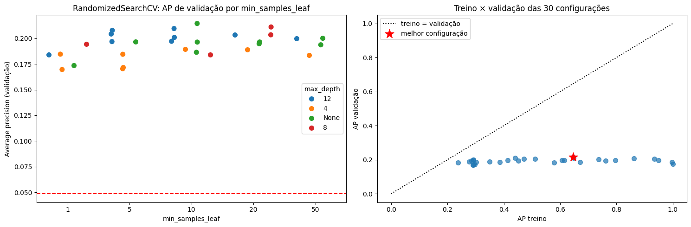
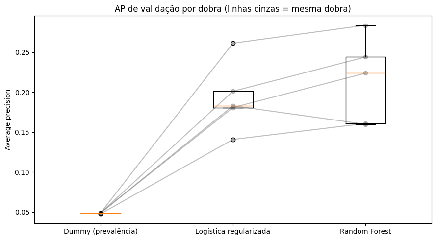
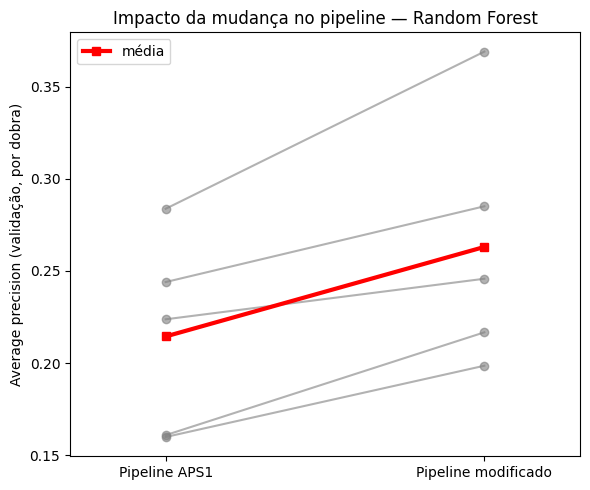
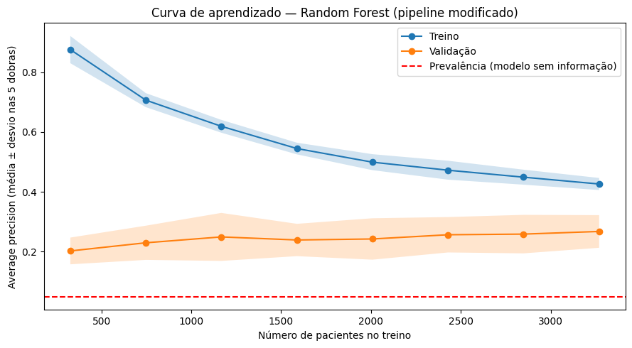

# 7. APS2 — Seleção e implementação dos modelos

## 7.1 Métrica de desempenho: average precision

A **AP** é a área sob a curva precisão-revocação. Foi escolhida por três motivos:
1. **Classe rara:** a acurácia é inútil (seção 6.2). A ROC-AUC também pode parecer otimista, porque a taxa de falsos positivos é dividida por 4 mil negativos e muda pouco mesmo com centenas de alarmes falsos (Saito & Rehmsmeier, 2015).
2. **Foco no AVC:** a AP só olha a classe positiva e resume, em todos os limiares, quantos AVCs são encontrados e quantos alertas são verdadeiros.
3. **Independência de limiar:** permite comparar modelos antes de escolher o corte. O corte é escolhido depois, pelo F2 (seção 8.1).

**Referência:** a AP de um modelo sem informação é igual à prevalência, **0,0487**. A ROC-AUC também é reportada.

## 7.2 Três modelos com o pipeline da APS1

| Modelo | Por que foi escolhido |
|---|---|
| **Dummy** (`strategy="prior"`) | Prevê sempre a prevalência. É o piso: qualquer modelo útil precisa superá-lo |
| **Logística com regularização L2** (`C=1`) | Rápida, convexa, interpretável (razões de chances) e um baseline forte para dados tabulares |
| **Random Forest** (300 árvores) | Média de árvores descorrelacionadas (Breiman, 2001). Captura não linearidades, como o risco que acelera após os 50 anos, e interações, sem precisar criá-las à mão |

| Modelo | AP treino | AP validação | ROC-AUC validação |
|---|---|---|---|
| Dummy | 0,0487 | 0,0487 ± 0,0005 | 0,500 |
| Logística L2 (C=1) | 0,1957 | **0,1925 ± 0,0412** | **0,840** |
| Random Forest (padrão) | **1,0000** | 0,1727 ± 0,0366 | 0,813 |

- **Dummy:** AP igual à prevalência e ROC-AUC 0,5, exatamente o esperado de um modelo sem informação.
- **Logística:** AP de treino ≈ validação, então não sobreajusta. Ela tem 4 vezes a AP do Dummy.
- **Random Forest padrão:** **AP de treino 1,0 e validação 0,17.** Com `min_samples_leaf=1`, cada árvore cresce até isolar cada paciente e **decora o treino**. Com só 199 AVCs, essa memorização não generaliza. Sem ajuste, a floresta fica **abaixo** da logística.

## 7.3 Busca de hiperparâmetros — logística (`GridSearchCV`)

A grade completa tem 44 combinações (11 × 2 × 2), todas testadas, com a mesma métrica (AP) e as mesmas 5 dobras:

| Hiperparâmetro | Valores | Papel |
|---|---|---|
| `C` | 10⁻³ … 10² (11 valores em escala log) | Inverso da força da regularização. `C` menor significa mais penalidade |
| `penalty` | L1, L2 | L1 (Lasso) pode zerar coeficientes; L2 (Ridge) encolhe todos |
| `class_weight` | `None`, `"balanced"` | Dar mais peso aos AVCs no treino |

**Melhor configuração: `C = 100`, L1, `class_weight="balanced"`, AP = 0,1934.**

O gráfico mostra que:
- **Com `C` ≤ 0,003 e L1 sem pesos, a AP cai para 0,049.** A penalidade zera todos os coeficientes e o modelo vira o Dummy: é o **subajuste** por excesso de regularização.
- **De `C` ≈ 0,1 em diante, todas as curvas ficam planas em ~0,19.** Mais liberdade não ajuda, porque com 15 variáveis e 4 mil pacientes o modelo não tem capacidade de sobreajustar.
- **O `C = 100` escolhido está no extremo da grade**, mas a diferença para `C = 0,1` (~0,002) é **20 vezes menor que o desvio entre dobras** (~0,04). Na prática, a regularização **não muda o desempenho**: o ganho da busca sobre o modelo sem ajuste foi de 0,1925 para 0,1934. Pelo critério de simplicidade, um `C` em torno de 0,1 seria igualmente defensável e daria coeficientes mais estáveis (seção 9.1).
- O `class_weight="balanced"` ajuda nos `C` pequenos, onde compensa a penalidade, e não faz diferença nos grandes.

## 7.4 Busca de hiperparâmetros — Random Forest (`RandomizedSearchCV`)

A grade completa teria 240 combinações. Foram sorteadas **30** (150 ajustes), porque a busca aleatória costuma achar configurações tão boas quanto a busca completa com uma fração do custo (Bergstra & Bengio, 2012).

| Hiperparâmetro | Valores | Papel |
|---|---|---|
| `min_samples_leaf` | 1, 5, 10, 20, 50 | Tamanho mínimo da folha. É o principal freio contra a memorização vista em 7.2 |
| `max_depth` | None, 4, 8, 12 | Profundidade máxima das árvores |
| `max_features` | `"sqrt"`, 0,3, 0,5 | Fração de variáveis sorteadas em cada divisão. Menos variáveis deixam as árvores mais diferentes entre si |
| `class_weight` | `None`, `"balanced_subsample"` | Peso dos AVCs, recalculado em cada amostra bootstrap |
| `n_estimators` | 200, 400 | Mais árvores nunca pioram o resultado, só custam tempo |

**Melhor configuração: 200 árvores, `min_samples_leaf=10`, `max_features=0.5`, `max_depth=None`, `class_weight=None`, AP = 0,2144 ± 0,0482.**

- **Painel da direita:** a AP de treino das 30 configurações vai de 0,24 a 1,0, mas a AP de validação fica entre 0,17 e 0,21 em todas. **Quanto mais o modelo decora o treino, mais longe ele fica da diagonal**, sem ganho na validação.
- A melhor configuração usa folhas de pelo menos 10 pacientes, ou seja, troca memorização por regras que valem para grupos.
- **Ganho da busca:** de 0,1727 para **0,2144** (+24%). Na floresta, o ajuste de hiperparâmetros importa muito mais que na logística.

## 7.5 Comparação após o ajuste

| Modelo | AP validação |
|---|---|
| Dummy | 0,0487 ± 0,0005 |
| Logística regularizada | 0,1934 ± 0,0392 |
| **Random Forest** | **0,2144 ± 0,0482** |

**A Random Forest foi escolhida como melhor modelo até aqui.** A diferença (0,021) é menor que o desvio entre as dobras, então a vantagem sobre a logística é **modesta**.

## 7.6 Mudança no pipeline

**Proposta:** duas alterações no tratamento das numéricas.

1. **Indicador de `bmi` ausente (`MissingIndicator`).** Na APS1, o `bmi` ausente foi preenchido com a mediana, o que apaga a informação de que ele estava faltando. A tabela abaixo mostra que **a ausência carrega muito sinal**:

   | `bmi` | Pacientes (treino) | Taxa de AVC |
   |---|---|---|
   | Registrado | 3.918 | 4,1% |
   | **Ausente** | **170** | **21,8%** |

   No dataset completo: 40 AVCs em 201 pacientes sem `bmi` (19,9%), contra 4,3% nos demais. **Um paciente sem `bmi` tem 5 vezes a taxa de AVC.**

2. **`log1p` em `avg_glucose_level` e `bmi` (`FunctionTransformer`).** A glicose é assimétrica e tem dois grupos (seção 2.2). O log comprime os valores extremos, o que importa para modelos lineares. Em árvores, transformações monotônicas não mudam as divisões possíveis, então **na Random Forest só o indicador pode fazer diferença**.

**Avaliação:** mesma métrica (AP), mesmas 5 dobras e **uma nova busca de hiperparâmetros** (outro `RandomizedSearchCV` com 30 configurações), já que a melhor configuração pode mudar com o novo pipeline.

| Pipeline | AP validação | Melhor configuração |
|---|---|---|
| APS1 | 0,2144 ± 0,0482 | 200 árvores, `min_samples_leaf=10`, `max_features=0.5`, sem limite de profundidade |
| **Modificado** | **0,2631 ± 0,0606** | 200 árvores, `max_depth=4`, `max_features="sqrt"`, `min_samples_leaf=1` |

- **Ganho: +0,049 de AP (+23%), com melhora em 5 de 5 dobras.** Como a comparação é pareada, nas mesmas dobras, a melhora consistente indica que não é ruído.
- A busca escolheu **árvores rasas (profundidade 4)**: com o indicador, poucas divisões (idade, glicose, hipertensão e `bmi` ausente) já capturam o sinal.
- **O pipeline modificado foi adotado. Melhor modelo final: Random Forest (pipeline modificado).**

> ⚠️ **Ressalva importante sobre a mudança.** A ausência do `bmi` provavelmente é um **artefato da coleta**, não um fator de risco. Por exemplo, pacientes internados após o AVC podem não ter sido pesados. Nesse caso, a ausência é uma **consequência** do AVC, e o modelo estaria aproveitando um vazamento de informação sobre o desfecho. Num uso real, em que o modelo prevê o risco **antes** do evento, esse sinal não existiria e o ganho de 0,049 desapareceria. Sem documentação de como os dados foram coletados (seção 10.2), não dá para confirmar nenhuma das duas hipóteses. Os resultados com o pipeline da APS1 (AP 0,214) devem ser vistos como uma estimativa mais conservadora.

## 7.7 Curva de aprendizado do melhor modelo

| Tamanho do treino | AP treino | AP validação |
|---|---|---|
| ~330 pacientes | 0,87 | 0,20 |
| ~1.600 | 0,55 | 0,24 |
| ~3.270 (tudo) | **0,43** | **0,27** |

**Diagnóstico: variância (sobreajuste moderado).**
- A AP de treino cai à medida que o treino cresce: com poucos pacientes o modelo decora, e com muitos isso fica impossível.
- A AP de validação **sobe devagar** (0,20 → 0,27) e não estabilizou.
- Ao final, sobra uma distância de **0,16** entre as duas curvas.

**Consequência prática:** coletar mais dados, principalmente mais casos de AVC, deve melhorar o modelo, mas devagar. A curva de validação ainda sobe, embora pouco. A faixa sombreada larga na validação (±0,05) reflete os ~40 AVCs por dobra: a estimativa da AP é ruidosa.
