# Previsão de AVC com Machine Learning — Relatório

**Dataset:** [Stroke Prediction Dataset](https://www.kaggle.com/datasets/fedesoriano/stroke-prediction-dataset) (Kaggle, fedesoriano)
**Notebook:** `stroke_prediction.ipynb` (APS1 + modelagem da APS2)
**Ferramentas:** Python, Pandas, NumPy, Matplotlib, Seaborn, Scikit-learn e SHAP

---

## Sumário

0. [Resumo executivo](#0-resumo-executivo)
1. [Os dados](#1-os-dados)
2. [APS1 — Análise exploratória, pré-processamento e clustering](#2-aps1--análise-exploratória-pré-processamento-e-clustering)
3. [Protocolo experimental da modelagem](#3-protocolo-experimental-da-modelagem)
4. [Regressão linear sobre o `stroke` (estudo exploratório)](#4-regressão-linear-sobre-o-stroke-estudo-exploratório)
5. [Regressão logística](#5-regressão-logística)
6. [Métricas de classificação](#6-métricas-de-classificação)
7. [APS2 — Seleção e implementação dos modelos](#7-aps2--seleção-e-implementação-dos-modelos)
8. [APS2 — Avaliação do melhor modelo no teste](#8-aps2--avaliação-do-melhor-modelo-no-teste)
9. [APS2 — Interpretação e explicabilidade](#9-aps2--interpretação-e-explicabilidade)
10. [APS2 — Discussão crítica](#10-aps2--discussão-crítica)
11. [Reprodutibilidade](#11-reprodutibilidade)
12. [Referências](#12-referências)

---

## 0. Resumo executivo

- **Problema:** prever se um paciente teve AVC (`stroke` = 1) a partir de 10 variáveis demográficas e clínicas. É uma **classificação binária muito desbalanceada**: só **4,87%** dos 5.110 pacientes tiveram AVC.
- **Métrica principal:** **average precision (AP)**. Ela foca na classe rara e não depende de limiar de decisão. Um modelo sem informação tem AP igual à prevalência, cerca de 0,049.
- **Modelos comparados:** Dummy, regressão logística regularizada e Random Forest, todos com o mesmo pipeline da APS1 e validação cruzada estratificada em 5 dobras.
- **Melhor modelo:** **Random Forest com o pipeline modificado**, que adiciona um indicador de `bmi` ausente e log em glicose e `bmi`. AP de validação: **0,263 ± 0,061**, contra 0,193 da logística e 0,049 do Dummy.
- **Resultado no teste** (1.022 pacientes, 50 AVCs, limiar 0,08 escolhido pelo F2):

  | Métrica | Valor |
  |---|---|
  | Recall | 0,80 (40 de 50 AVCs encontrados) |
  | Precision | 0,183 |
  | F1 | 0,297 |
  | Accuracy | 0,815 |
  | ROC-AUC | 0,844 |
  | Average precision | 0,230 |

- **O que mais pesa nas previsões:** idade, glicose média, hipertensão, ausência de `bmi` e doença cardíaca.
- **Principal ressalva:** o ganho da mudança no pipeline vem de um padrão de coleta. A taxa de AVC é de ~20% entre os pacientes sem `bmi` registrado e de ~4% entre os demais. Esse sinal pode não existir em um uso real do modelo (seção 7.5).

---

## 1. Os dados

### 1.1 Origem

O dataset foi publicado no Kaggle por fedesoriano e é descrito apenas como "confidencial". **Não há informação sobre o hospital ou país de origem, o período de coleta, o critério de inclusão dos pacientes ou a forma de diagnóstico do AVC.** Essa falta de documentação é uma das limitações discutidas na seção 10.

O download é feito no próprio notebook com `kagglehub.dataset_download("fedesoriano/stroke-prediction-dataset")`, sem precisar de login, já que o dataset é público.

### 1.2 Dimensões e variáveis

São **5.110 pacientes** (linhas) e **12 colunas**.

| Variável | Tipo | Descrição | Valores |
|---|---|---|---|
| `id` | inteiro | Identificador do paciente | 5.110 únicos (removido da modelagem) |
| `gender` | categórica | Sexo | Female 2.994 · Male 2.115 · Other 1 |
| `age` | contínua | Idade (anos) | 0,08 a 82; média 43,2; mediana 45 |
| `hypertension` | binária | Hipertensão | 1 = 498 (9,75%) |
| `heart_disease` | binária | Doença cardíaca | 1 = 276 (5,40%) |
| `ever_married` | categórica | Já foi casado(a) | Yes 3.353 · No 1.757 |
| `work_type` | categórica | Tipo de trabalho | Private 2.925 · Self-employed 819 · children 687 · Govt_job 657 · Never_worked 22 |
| `Residence_type` | categórica | Moradia | Urban 2.596 · Rural 2.514 |
| `avg_glucose_level` | contínua | Glicose média (mg/dL) | 55 a 272; média 106,2; mediana 91,9; dp 45,3 |
| `bmi` | contínua | Índice de massa corporal | 201 ausentes (3,93%); média 28,9; mediana 28,1; dp 7,85 |
| `smoking_status` | categórica | Tabagismo | never smoked 1.892 · Unknown 1.544 · formerly smoked 885 · smokes 789 |
| **`stroke`** | **binária (alvo)** | **Teve AVC** | **1 = 249 (4,87%) · 0 = 4.861 (95,13%)** |

### 1.3 Qualidade dos dados

| Verificação | Resultado | Decisão |
|---|---|---|
| Valores nulos (`NaN`) | Só no `bmi`: 201 (3,93%) | Preencher com a mediana (APS1). Na APS2, também criar um indicador de ausência (seção 7.5) |
| Valores `None` em colunas de texto | Nenhum | — |
| Zeros impossíveis (`bmi` = 0, glicose = 0) | Nenhum. Os zeros só aparecem nas binárias, onde são legítimos | — |
| `age` fora de [0, 121] | Nenhum | Mantido. Idades fracionárias (0,08) correspondem a bebês |
| `avg_glucose_level` fora de [30, 600] | Nenhum | — |
| `bmi` fora de [10, 80] | 2 pacientes: 97,6 e 92,0 (17 e 38 anos, sem AVC) | Mantidos. São valores extremos mas fisicamente possíveis, e o `StandardScaler` e as árvores toleram esses pontos |
| `gender = "Other"` | 1 paciente | Substituído pela moda (`Female`). Uma categoria com um único exemplo não permite aprender nada e geraria uma coluna quase constante no one-hot |
| `smoking_status = "Unknown"` | 1.544 (30,22%) | Mantido como categoria própria. É um volume grande demais para descartar, e a própria ausência é informativa: a taxa de AVC no `Unknown` é de 3,0%, a menor de todas, porque muitas crianças não têm esse dado |

### 1.4 O desbalanceamento

Só **249 pacientes (4,87%)** tiveram AVC. Essa é a característica que mais influencia o trabalho:
- Um modelo que sempre responde "sem AVC" acerta **95,1%**. Por isso a **acurácia não serve como métrica principal** (seção 6).
- Com 80/20, sobram só **199 AVCs no treino** e **50 no teste**. Cada AVC a mais ou a menos detectado no teste muda o recall em 2 pontos percentuais.

---

## 2. APS1 — Análise exploratória, pré-processamento e clustering

### 2.1 Distribuição do alvo

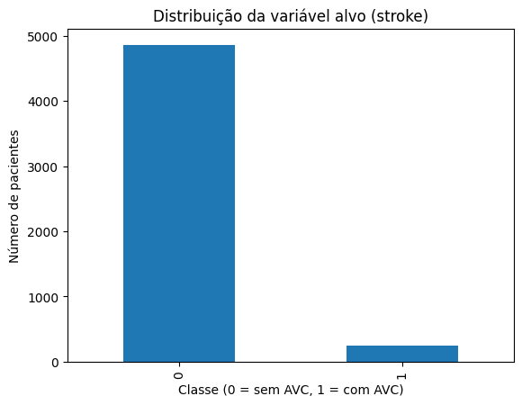

A barra da classe 1 é cerca de 20 vezes menor que a da classe 0 (249 × 4.861). É o desbalanceamento descrito na seção 1.4.

### 2.2 Estatísticas das numéricas

| Variável | Média | Mediana | Desvio padrão |
|---|---|---|---|
| `age` | 43,23 | 45,00 | 22,61 |
| `hypertension` | 0,10 | 0,00 | 0,30 |
| `heart_disease` | 0,05 | 0,00 | 0,23 |
| `avg_glucose_level` | 106,15 | 91,88 | 45,28 |
| `bmi` | 28,89 | 28,10 | 7,85 |
| `stroke` | 0,05 | 0,00 | 0,22 |

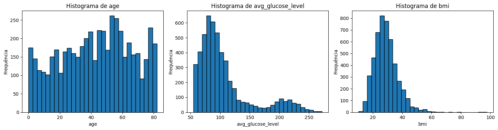
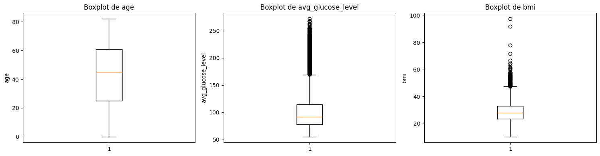

- **`age`:** distribuição larga e aproximadamente uniforme entre 0 e 82 anos. A média (43,2) fica perto da mediana (45).
- **`avg_glucose_level`:** a média (106,2) é bem maior que a mediana (91,9), o que indica **assimetria à direita**. A maioria dos pacientes está entre 60 e 120 mg/dL, e um segundo grupo fica entre 180 e 270 mg/dL, faixa compatível com diabetes. Os boxplots mostram muitos pontos acima do bigode superior. Essa assimetria motivou o `log1p` da mudança no pipeline (seção 7.5).
- **`bmi`:** levemente assimétrico, com dois valores extremos (92 e 97,6).

### 2.3 Categóricas

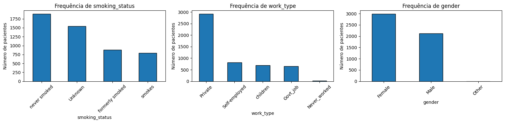

Três categorias são muito pequenas e voltam a aparecer na interpretação dos modelos:
- `gender = Other`: 1 paciente;
- `work_type = Never_worked`: 22 pacientes, **nenhum** com AVC;
- `work_type = children`: 687 pacientes, só 2 com AVC.

### 2.4 Separação treino/teste da APS1

`train_test_split(test_size=0.2, stratify=y, random_state=42)` gerou **4.088 pacientes no treino e 1.022 no teste**, com 4,87% e 4,89% de AVC. O `stratify=y` garante que os dois conjuntos tenham a mesma proporção de AVC. Sem ele, o teste poderia ficar com bem menos de 50 casos por acaso. A análise bivariada a seguir usa **só o treino**, para que nenhuma decisão seja tomada olhando o teste.

### 2.5 Relação com o alvo

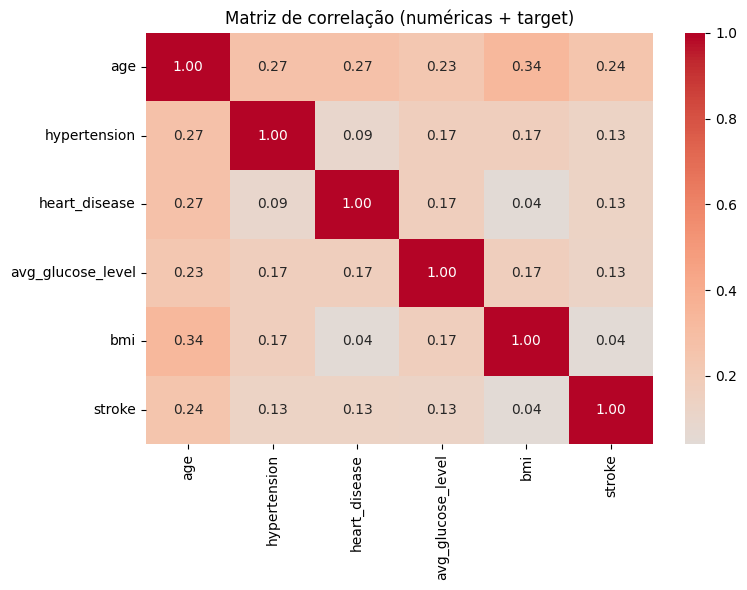

Correlação de cada numérica com `stroke` no treino:

| Variável | Correlação com `stroke` |
|---|---|
| `age` | **0,243** |
| `hypertension` | 0,133 |
| `heart_disease` | 0,127 |
| `avg_glucose_level` | 0,125 |
| `bmi` | 0,044 |

**A idade é de longe o fator mais associado ao AVC.** As médias por grupo, no dataset completo, confirmam isso:

| Grupo | Idade média | Glicose média | `bmi` médio |
|---|---|---|---|
| Sem AVC | 42,0 | 104,8 | 28,8 |
| Com AVC | **67,7** | **132,5** | 30,5 |

Metade dos AVCs ocorreu em pacientes com 71 anos ou mais, e só **8 dos 249** AVCs ocorreram antes dos 40 anos.

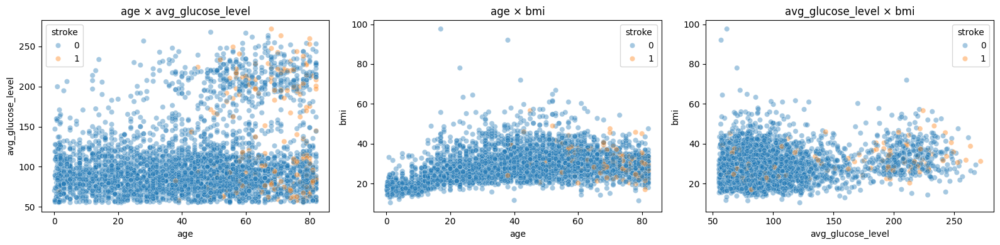
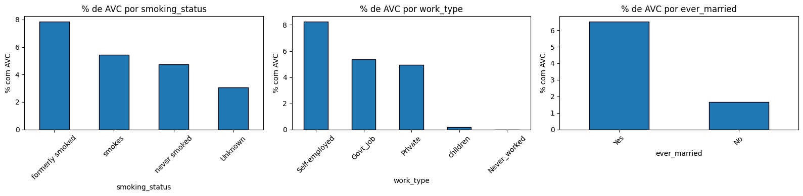

Taxa de AVC por `smoking_status` (treino):

| `smoking_status` | Taxa de AVC |
|---|---|
| formerly smoked | **7,8%** |
| smokes | 5,4% |
| never smoked | 4,7% |
| Unknown | 3,0% |

O grupo de **ex-fumantes** tem a maior taxa, e não o de fumantes atuais. O mais provável é um efeito de idade: ex-fumantes são mais velhos, e pessoas que tiveram um evento de saúde costumam parar de fumar. É um exemplo de **associação que não é causa**. Pelo mesmo motivo, no dataset completo `Self-employed` tem 7,9% de AVC (são trabalhadores mais velhos) e `children` tem 0,3%.

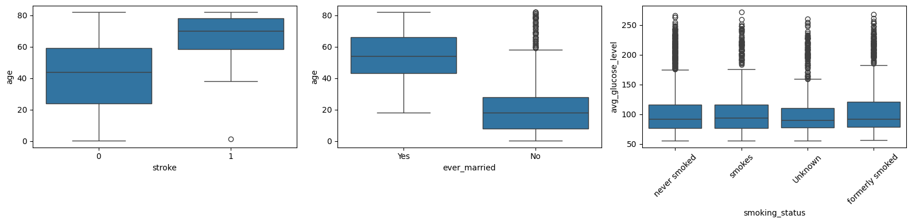

### 2.6 Pré-processamento da APS1

| Etapa | Ferramenta | Justificativa |
|---|---|---|
| Remover `id` | `drop` | É um identificador, sem valor preditivo. Mantê-lo deixaria o modelo decorar pacientes |
| `gender`: `Other` → `Female` | `replace` | Categoria com 1 exemplo (seção 1.3) |
| `bmi` ausente → mediana | `SimpleImputer(strategy="median")` | A mediana é robusta aos valores extremos (92 e 97,6) |
| Numéricas → média 0, dp 1 | `StandardScaler` | Coloca idade (0–82), glicose (55–272) e `bmi` na mesma escala. Isso é necessário para distâncias (K-Means), PCA e modelos lineares |
| Categóricas → colunas 0/1 | `OneHotEncoder(handle_unknown="ignore")` | Modelos numéricos não aceitam texto, e o one-hot não impõe uma ordem que não existe entre as categorias |
| Organização | `ColumnTransformer` | Aplica cada transformação ao seu grupo de colunas |

O resultado foi uma matriz de **5.110 × 20** (5 numéricas + 15 colunas de one-hot).

> **Observação metodológica:** na APS1, o `fit_transform` foi aplicado ao dataset inteiro. Para o clustering (não supervisionado) isso é aceitável, mas em um modelo supervisionado avaliado em teste seria **vazamento de dados**: a mediana e a escala seriam calculadas também com os pacientes de teste. Na APS2, o mesmo pré-processamento foi colocado **dentro de um `Pipeline`**, ajustado só no treino de cada dobra (seção 3.3).

### 2.7 PCA e K-Means

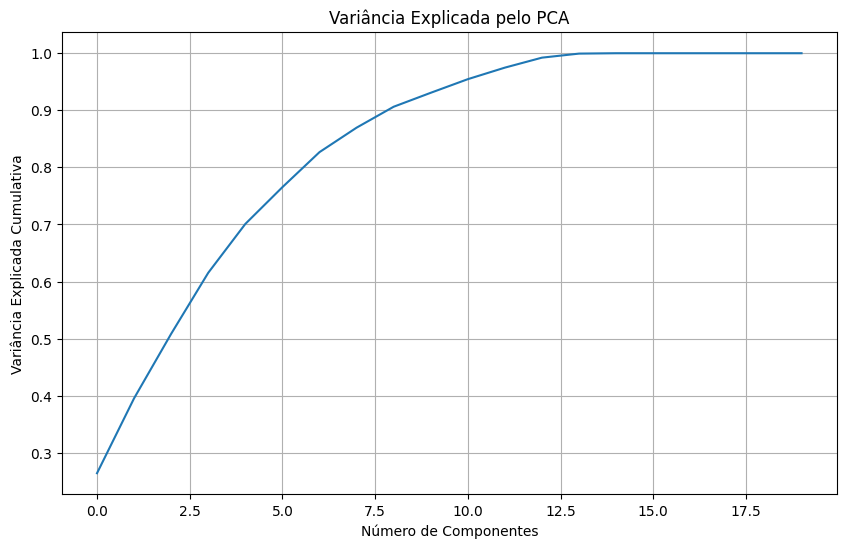

O PCA foi aplicado à matriz pré-processada para estudar a dimensionalidade, com 10 componentes retidos. Os *loadings* dos dois primeiros componentes mostram o que eles representam:
- **CP1:** dominado por `age` (0,58), `bmi` (0,42), `hypertension` (0,36), glicose (0,35) e `heart_disease` (0,29). É um eixo de **idade e risco cardiometabólico**.
- **CP2:** dominado por `heart_disease` (0,72), positivamente, e `bmi` (−0,53), negativamente.

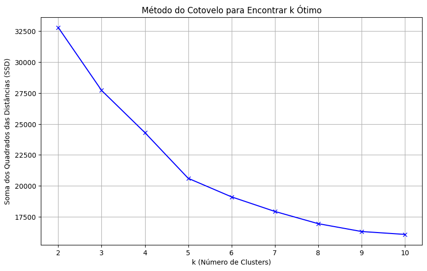
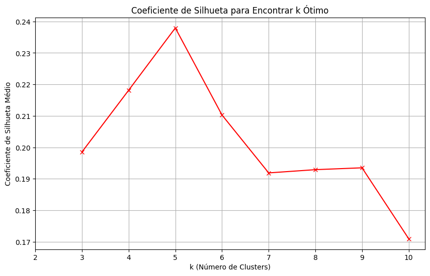

O coeficiente de silhueta teve o máximo em **k = 5 (0,238)**, por isso o K-Means usou 5 clusters. Uma silhueta de 0,24 é baixa: os grupos existem, mas **se sobrepõem bastante**, o que é esperado em dados de pacientes sem segmentos naturais bem definidos.

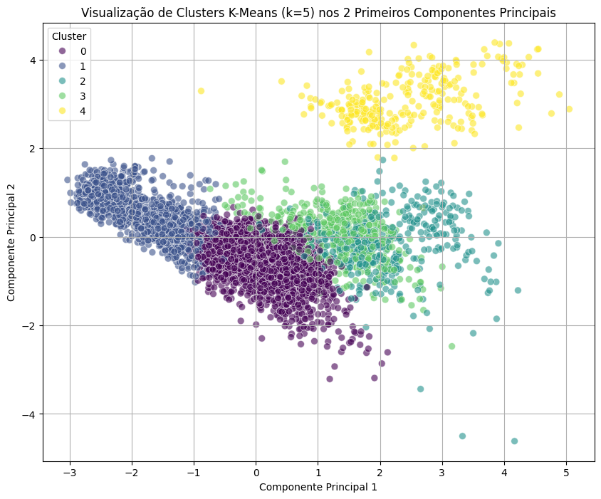
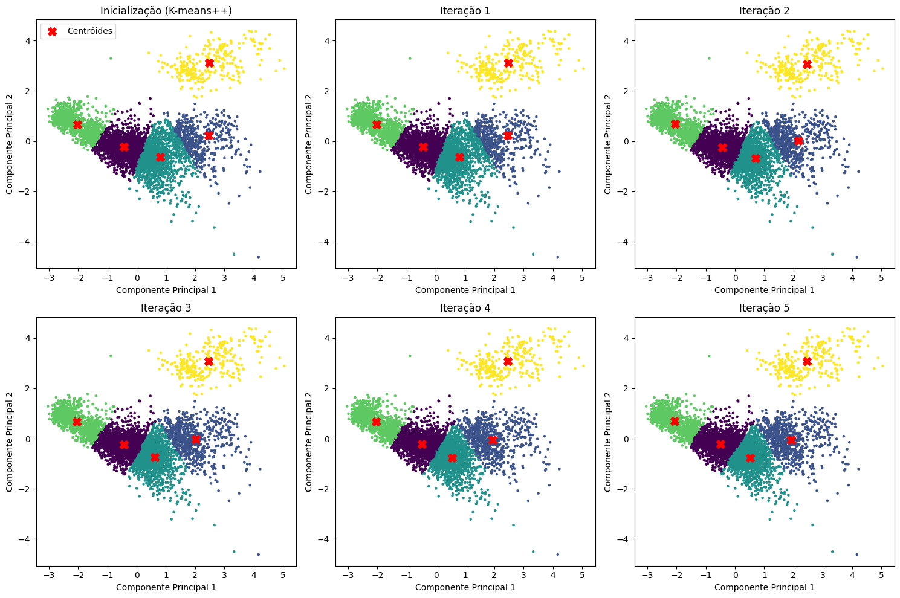

---

## 3. Protocolo experimental da modelagem

### 3.1 Separação treino/teste

| Conjunto | Pacientes | AVCs | Prevalência |
|---|---|---|---|
| Treino | 4.088 | 199 | 4,87% |
| Teste | 1.022 | 50 | 4,89% |

A divisão é a mesma da APS1 (80/20, estratificada, `random_state=42`). **O teste fica guardado:** nenhuma escolha de modelo, hiperparâmetro ou limiar usa o teste. Se ele fosse usado para escolher, o número final estaria otimista, porque o modelo seria escolhido justamente por ter ido bem naquele conjunto.

### 3.2 Validação cruzada

Toda comparação usa `StratifiedKFold(n_splits=5, shuffle=True, random_state=42)` sobre o treino:
- **5 dobras:** cada paciente é validado uma vez, e o desempenho é a média de 5 medidas, com o desvio entre as dobras indicando a incerteza.
- **Estratificada:** cada dobra tem ~40 AVCs. Sem estratificação, alguma dobra poderia ficar com poucos casos e a métrica oscilaria muito.
- **`shuffle=True`:** evita que alguma ordem do arquivo afete as dobras.
- **O mesmo objeto `cv` em tudo:** os modelos são avaliados nas **mesmas** dobras, o que permite comparações pareadas, dobra a dobra.

### 3.3 Pipeline (sem vazamento)

```
Pipeline
├── ColumnTransformer
│   ├── numéricas  → SimpleImputer(median) → StandardScaler
│   └── categóricas → OneHotEncoder(drop="first", handle_unknown="ignore")
└── modelo
```

- **Dentro do `Pipeline`, a mediana, a média, o desvio e as categorias são aprendidos só no treino de cada dobra** e depois aplicados à validação. Isso reproduz o uso real, em que o modelo nunca viu o paciente novo.
- **`drop="first"`:** remove uma categoria de referência por variável, para que as colunas do one-hot não sejam redundantes com o intercepto. Assim a matriz tem posto completo e os coeficientes ficam identificáveis. O resultado são **15 colunas** (5 numéricas + 10 de one-hot), contra 20 na APS1.
- **`handle_unknown="ignore"`:** se uma categoria rara, como `Never_worked`, não aparecer no treino de alguma dobra, a validação não quebra.

---

## 4. Regressão linear sobre o `stroke` (estudo exploratório)

Antes da classificação, o notebook estuda o que acontece ao tratar `stroke` (0/1) com **regressão linear**. Essa abordagem se chama **modelo de probabilidade linear**: o valor previsto seria a chance de AVC. O objetivo é mostrar, com os próprios dados, por que esse caminho falha e por que a regressão logística é a escolha correta.

### 4.1 Regressão simples feita à mão: `stroke` × `age`

As equações normais (XᵀX w = Xᵀy) foram resolvidas com `np.linalg.solve`, que resolve o sistema diretamente, sem inverter a matriz.

| Resultado | Valor |
|---|---|
| w₀ (intercepto) | −0,05183 |
| w₁ (idade) | 0,00232 |
| Conferência: r · s_y / s_x | 0,00232 (r = 0,2434) ✔ |
| Σe (soma dos resíduos) | −1,8 × 10⁻¹⁴ ≈ 0 ✔ |
| Σe·x | 2,9 × 10⁻¹² ≈ 0 ✔ |

As duas somas nulas confirmam as propriedades da solução de mínimos quadrados: os resíduos têm média zero e são ortogonais à variável explicativa.

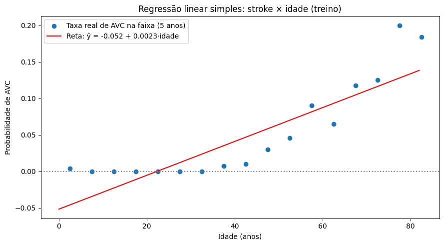

**Interpretação:** cada ano a mais soma 0,23 ponto percentual à "probabilidade" prevista. A reta, no entanto, **fica negativa abaixo de ~22 anos** (−0,0518 + 0,00232 · idade < 0), e a taxa real de AVC cresce de forma **curva**: quase zero até os 40 anos, acelerando depois. Uma reta não reproduz essa forma.

### 4.2 Regressão linear múltipla

Validação cruzada em 5 dobras:

| Modelo | RMSE validação | MAE validação | R² validação |
|---|---|---|---|
| Dummy (média) | 0,2152 | 0,0926 | 0,000 |
| Regressão linear (OLS) | **0,2070** | 0,0941 | **0,0745** |

O OLS explica só **7,5% da variância**. Isso é esperado num alvo 0/1 raro: a maior parte da variação é individual e não está nas variáveis. O MAE do OLS chega a ficar pior que o do Dummy. Prever sempre ~0,05 erra pouco na maioria dos pacientes, que não tiveram AVC.

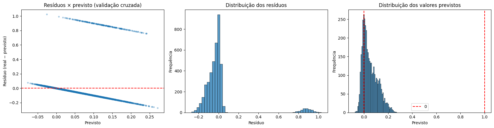

O gráfico de resíduos mostra três problemas:
1. **Duas faixas diagonais:** como y só vale 0 ou 1, o resíduo é sempre −ŷ ou 1 − ŷ. Os resíduos não podem ter distribuição normal.
2. **Heteroscedasticidade:** a variância de um alvo binário é p(1−p), que muda com p. O espalhamento dos resíduos varia ao longo do eixo.
3. **25,4% das previsões são negativas:** uma "probabilidade" negativa não tem sentido.

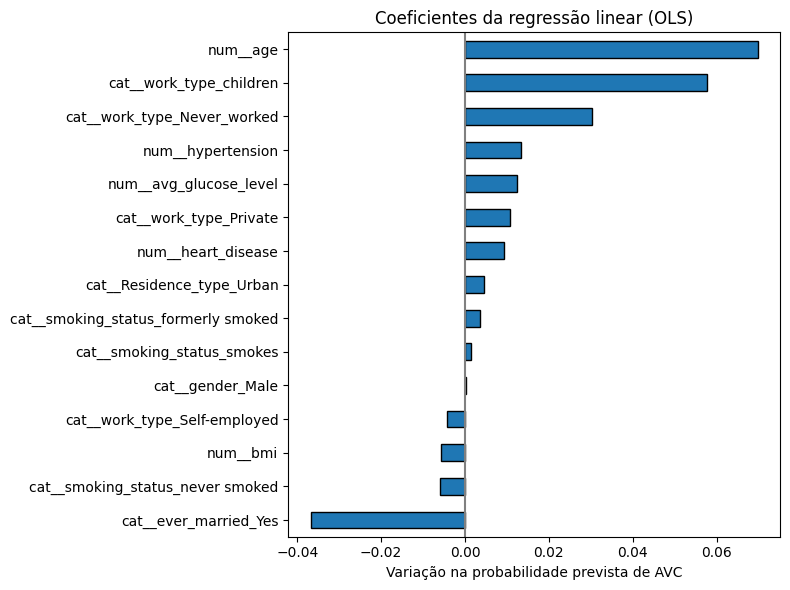

### 4.3 Gradiente descendente

O mesmo problema foi resolvido pelo gradiente descendente, w ← w − η·∇J, com ∇J = −(2/n)Xᵀ(y − Xw). A referência é a forma fechada (RMSE de treino 0,20612).

| η | RMSE após 2.000 iterações | Maior distância aos pesos ótimos |
|---|---|---|
| 0,001 | 0,20715 | 0,046 |
| 0,01 | 0,20613 | 0,028 |
| 0,1 | **0,20612** | 0,009 |

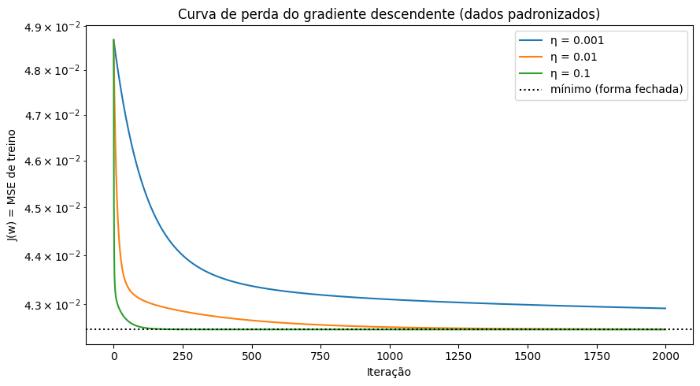

Com η = 0,1, o gradiente descendente chega praticamente à mesma solução da forma fechada. Com η menor, ele ainda não convergiu em 2.000 iterações.

**Por que padronizar.** O gradiente descendente só converge se η < 2/λ_max, onde λ_max é o maior autovalor de (2/n)XᵀX (a curvatura máxima da função de perda):

| Dados | λ_max | Limite de η | Razão λ_max/λ_min |
|---|---|---|---|
| Crus (idade, glicose, `bmi`) | 31.901,7 | 6,3 × 10⁻⁵ | 289.580 |
| Padronizados | 2,97 | 0,673 | 2 |

Com os dados crus, η = 0,01 está 160 vezes acima do limite. A perda **explode** de 0,049 para 3,7 × 10⁴² em 10 iterações. Com os dados padronizados, o mesmo η converge suavemente. A glicose, com valores na casa das centenas, cria uma curvatura enorme numa direção. **Esse é o motivo de o `StandardScaler` vir antes de qualquer modelo treinado por gradiente ou com penalidade.**

**Mini-batch** (uma época, η = 0,01):

| batch_size | Passos | RMSE final |
|---|---|---|
| 1 | 4.088 | 0,279 (instável) |
| 32 | 128 | **0,2075** |
| 1.024 | 4 | 0,2169 (poucos passos) |

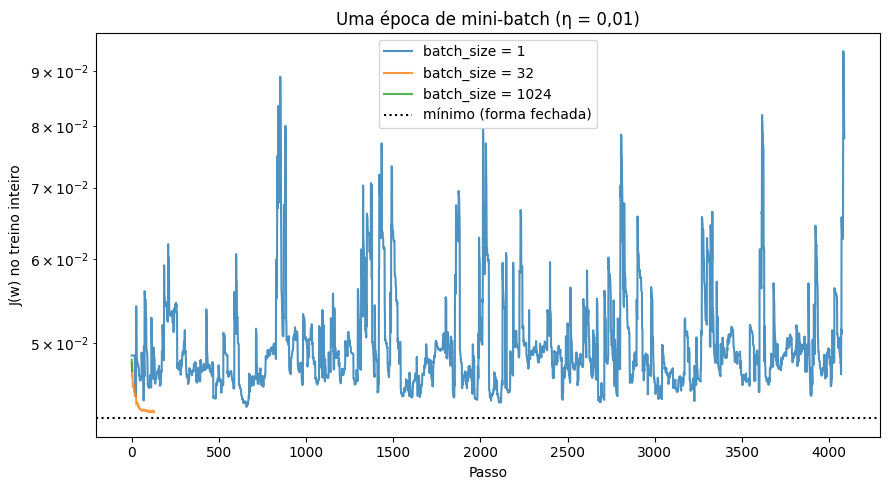

Com lote 32, o mini-batch chega perto do ótimo numa única passada pelos dados. Com lote 1, o ruído de cada passo atrapalha. Com lote 1.024, são só 4 passos, e o modelo não chega lá. O `SGDRegressor` do scikit-learn ficou com RMSE de validação 0,2074, praticamente igual ao OLS.

### 4.4 Atributos polinomiais: subajuste × sobreajuste

| Grau | Nº de colunas | RMSE treino | RMSE validação | Desvio entre dobras | R² validação |
|---|---|---|---|---|---|
| 1 | 15 | 0,2060 | **0,2070** | 0,0015 | **0,075** |
| 2 | 135 | 0,2005 | 0,2108 | 0,0042 | 0,041 |
| 3 | 815 | 0,1840 | 0,2635 | **0,0170** | **−0,507** |

No grau 3, o erro de treino cai, mas o de validação sobe e o desvio entre dobras fica 11 vezes maior. É **sobreajuste**: o modelo erra de forma imprevisível em dados novos, e o R² negativo indica que ele fica pior que prever a média.

### 4.5 Regularização: Ridge, Lasso e Elastic Net

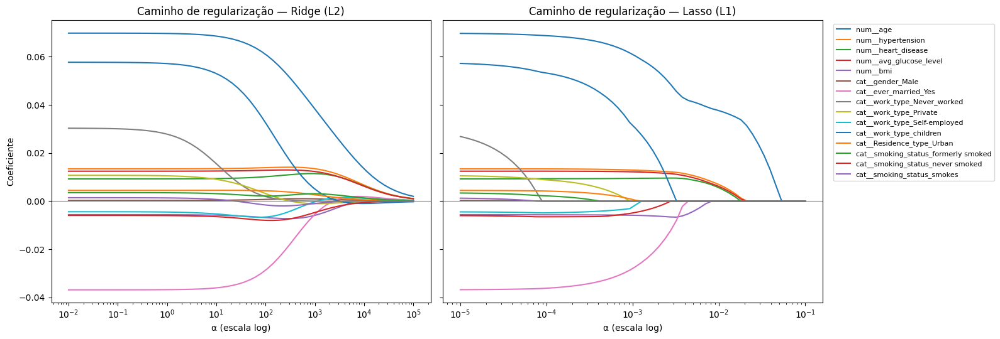

- No **Ridge**, conforme α cresce, todos os coeficientes encolhem juntos, mas nenhum chega a zero.
- No **Lasso**, os coeficientes **vão sendo zerados** um a um: com α = 0,0001 restam 13 de 15; com 0,001, 10; com 0,005, 5; com 0,01, só 4. As que sobrevivem por último são as mais informativas.

O α foi escolhido por validação cruzada (`RidgeCV`, `LassoCV`, `ElasticNetCV`), nunca pelo erro de treino, que sempre prefere α = 0:

| Modelo | α escolhido | Coeficientes não nulos | RMSE validação |
|---|---|---|---|
| Ridge | 37,28 | 15/15 | 0,2070 |
| Lasso | 0,00040 | 12/15 | 0,2070 |
| Elastic Net (l1_ratio = 0,9) | 0,00044 | 12/15 | 0,2070 |
| Polinomial grau 3 + Ridge | — | 815 | 0,2081 |

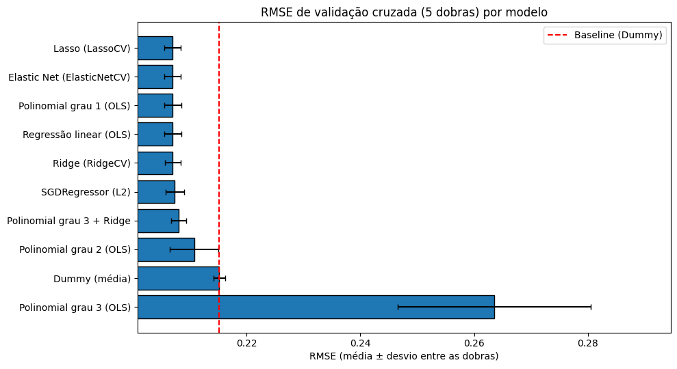

**Interpretação:**
- Com apenas 15 colunas e 4 mil pacientes, quase não há sobreajuste para corrigir, então a regularização não muda o desempenho. Ela só simplifica o modelo: o Lasso dispensa 3 variáveis sem perda.
- No polinomial de grau 3, o Ridge faz a diferença: o RMSE de validação cai de 0,2635 para 0,2081.

**Teste** (avaliado uma vez):

| Modelo | RMSE teste | R² teste |
|---|---|---|
| Dummy | 0,2157 | 0,000 |
| OLS | 0,2056 | 0,091 |
| Ridge / Lasso / Elastic Net | 0,2057 | 0,090 |
| Polinomial grau 3 + Ridge | **0,2054** | **0,093** |

**Conclusão da seção:** a regressão linear até supera o baseline, mas viola as premissas do modelo (resíduos em faixas, variância não constante, previsões negativas). **O problema é de classificação** e é tratado como tal a partir daqui.

---

## 5. Regressão logística

### 5.1 Reta × sigmoide

A regressão logística passa o escore linear z = wᵀx + b pela sigmoide, σ(z) = 1/(1 + e⁻ᶻ). Com isso, a saída fica sempre entre 0 e 1.

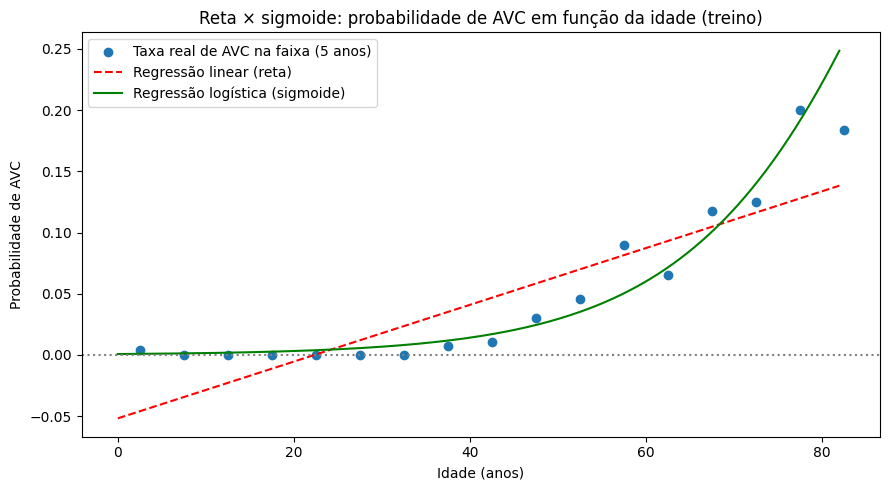

Com só a idade (sem penalidade): **w = 0,0748, b = −7,241**. A sigmoide acompanha a forma curva da taxa real: quase zero nos jovens e acelerando após os 50 anos, justamente o que a reta da seção 4.1 não conseguia.

| Idade | z | Probabilidade de AVC | `predict` |
|---|---|---|---|
| 30 | −4,997 | 0,67% | 0 |
| 60 | −2,752 | 6,0% | 0 |
| 80 | −1,256 | **22,2%** | 0 |

O `predict_proba` coincide exatamente com σ(`decision_function`). Mesmo aos 80 anos a probabilidade fica abaixo de 0,5, então o `predict` (corte em 0,5) devolve 0 para todos. **Com ~5% de prevalência, o limiar padrão quase nunca é atingido** (seção 5.5).

### 5.2 Chances (odds)

- **e^w = 1,0777:** cada ano a mais de idade multiplica a chance de AVC por **1,078** (+7,8%).
- **A cada 10 anos**, a chance é multiplicada por **2,11**.
- A razão entre as chances de idades vizinhas (50 → 51 → 52) é constante (1,0777), o que confirma que o efeito é multiplicativo na escala da chance.

### 5.3 Entropia cruzada e gradiente

| Modelo | Entropia cruzada (log loss) |
|---|---|
| Sempre 0,5 | 0,6931 (= ln 2) |
| Sempre a prevalência | 0,1946 |
| Logística só com a idade | **0,1584** |

O cálculo à mão e o `log_loss` do scikit-learn dão o mesmo valor (0,1584). A idade sozinha já reduz a perda em 19% em relação a prever sempre a prevalência.

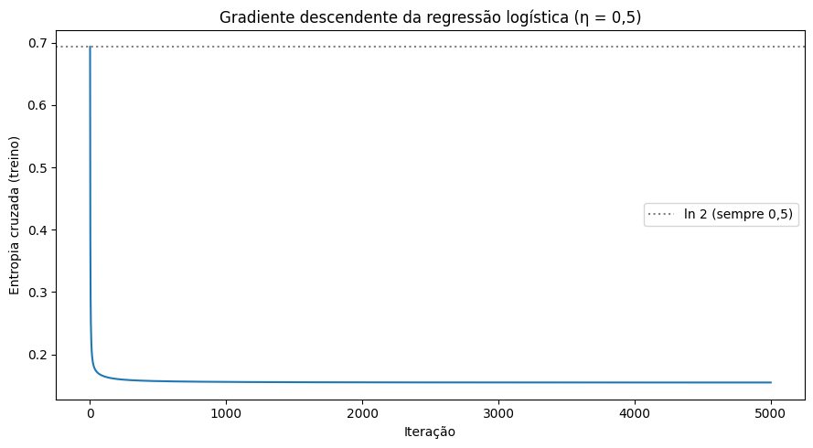

O gradiente descendente com todas as variáveis (∇J = (1/n)Xᵀ(p̂ − y), η = 0,5, 5.000 iterações) parte de 0,6931 e chega a **0,1551**, a mesma perda do scikit-learn. Mesmo assim, os pesos diferem em até 0,69. O motivo é a categoria **`Never_worked`: 22 pacientes, nenhum com AVC**. Para essa coluna, a perda continua diminuindo enquanto o coeficiente vai para −∞, uma **separação quase completa**. Cada otimizador para num ponto diferente dessa direção sem fundo, e a perda quase não muda. É um primeiro sinal de que essa categoria vai distorcer os coeficientes (seção 9.1).

### 5.4 Coeficientes como razões de chances

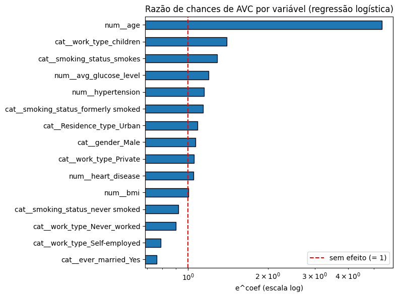

Logística com todas as variáveis, sem penalidade:

| Variável | Razão de chances |
|---|---|
| `age` (+1 dp ≈ 22,6 anos) | **5,36** |
| `work_type_children` | 1,40 |
| `smoking_status_smokes` | 1,28 |
| `avg_glucose_level` (+1 dp) | 1,19 |
| `hypertension` (+1 dp) | 1,15 |
| … | … |
| `ever_married_Yes` | 0,76 |

Mantendo as outras variáveis fixas, 22,6 anos a mais multiplicam a chance de AVC por 5,4. A razão de chances de `children` (1,40) contradiz a intuição: não significa que crianças tenham mais AVC. Como a idade já está no modelo, esse coeficiente só **corrige** a previsão da idade para esse grupo, e é instável porque há só 2 AVCs entre 687 crianças.

### 5.5 Limiar de decisão

Probabilidades **fora da dobra** no treino, em que cada paciente é previsto por um modelo que não o viu:

| Limiar | AVCs previstos | AVCs perdidos (de 199) | Alarmes falsos | Acurácia |
|---|---|---|---|---|
| 0,5 | 1 | **199** | 1 | 0,951 |
| 0,3 | 54 | 186 | 41 | 0,944 |
| 0,2 | 208 | 154 | 163 | 0,922 |
| 0,1 | 687 | 83 | 571 | 0,840 |
| 0,05 | 1.192 | 42 | 1.035 | 0,737 |

Com o limiar 0,5, o modelo **não detecta nenhum AVC** e ainda assim tem 95,1% de acurácia. Baixar o limiar troca alarmes falsos por AVCs encontrados. **A acurácia não mostra essa troca**, o que motiva as métricas da seção 6.

### 5.6 Termos polinomiais na logística

| Modelo | Log loss treino | Log loss validação |
|---|---|---|
| Grau 1 | 0,1547 | **0,1582 ± 0,0030** |
| Grau 2 | 0,1367 | 0,1849 ± 0,0153 |

O grau 2 sobreajusta: o treino melhora, a validação piora e fica 5 vezes mais instável. **O modelo linear (grau 1) foi mantido.**

---

## 6. Métricas de classificação

**Premissa de custo:** num problema de saúde, **deixar de detectar um AVC (falso negativo) custa mais caro** que um alarme falso (falso positivo), que só leva a exames adicionais. Essa assimetria guia todas as escolhas abaixo.

### 6.1 Matriz de confusão e o paradoxo da acurácia

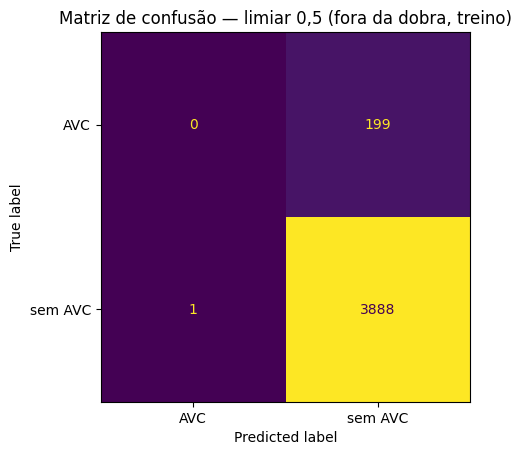

A matriz é montada com `labels=[1, 0]`, para o AVC (positivo) aparecer primeiro. Com o limiar 0,5 (fora da dobra): **TP = 0, FN = 199, FP = 1, TN = 3.888**.

Conferência das métricas à mão, com limiar 0,2 (TP 45, FN 154, FP 163, TN 3.726). Os valores calculados à mão e pelo scikit-learn foram idênticos:

| Métrica | Fórmula | Valor |
|---|---|---|
| Acurácia | (TP+TN)/total | 0,9225 |
| Precisão | TP/(TP+FP) | 0,2163 |
| Revocação | TP/(TP+FN) | 0,2261 |
| Especificidade | TN/(TN+FP) | 0,9581 |
| F1 | 2TP/(2TP+FP+FN) | 0,2211 |

### 6.2 Comparação com baselines

| Modelo | Acurácia | Precisão | Revocação | F1 | F2 | Acur. balanceada | MCC |
|---|---|---|---|---|---|---|---|
| Dummy (sempre sem AVC) | **0,951** | 0,000 | 0,000 | 0,000 | 0,000 | 0,500 | 0,000 |
| Dummy (estratificado) | 0,895 | 0,058 | 0,075 | 0,065 | 0,071 | 0,506 | 0,011 |
| Logística, limiar 0,5 | **0,951** | 0,000 | 0,000 | 0,000 | 0,000 | 0,500 | −0,004 |
| Logística, limiar 0,1 | 0,840 | 0,169 | **0,583** | 0,262 | 0,391 | **0,718** | **0,251** |

**Paradoxo da acurácia:** o Dummy que nunca prevê AVC tem a **maior acurácia** da tabela. A acurácia balanceada (média entre revocação e especificidade) e o MCC (correlação entre o previsto e o real; Chicco & Jurman, 2020) não se deixam enganar: os dois dão zero de ganho para o Dummy e mostram a vantagem real da logística com limiar baixo.

### 6.3 Escolha do limiar pelo F2

O **F2** é um F-beta com β = 2, que dá à revocação quatro vezes o peso da precisão. Ele traduz a premissa de custo.

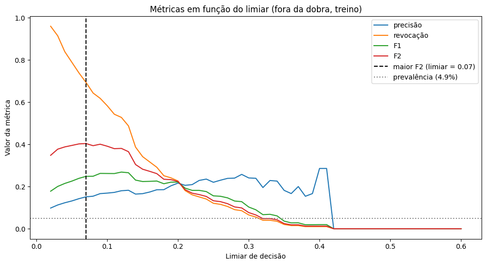

O limiar que maximiza o F2 fora da dobra foi **0,07**, com precisão 0,151, revocação 0,693, F1 0,248 e F2 0,404. O `class_weight="balanced"`, que muda os pesos das classes no treino em vez de mudar o corte, chegou a um equilíbrio parecido (revocação 0,789, F2 0,397, MCC 0,250). Mudar o limiar e reponderar as classes são duas formas equivalentes de trocar alarmes falsos por AVCs encontrados.

**Por que a precisão é sempre baixa:** com 5% de prevalência, mesmo um bom modelo gera muitos alarmes falsos para cada AVC encontrado. A precisão deve sempre ser lida **junto com a prevalência**: 0,15 de precisão significa que um alerta tem 3 vezes a taxa de base (0,049).

### 6.4 Qualidade das probabilidades

| Modelo | Log loss | Brier |
|---|---|---|
| Dummy (prevalência) | 0,1946 | 0,0463 |
| Logística | **0,1582** | **0,0429** |
| Logística `balanced` | 0,5126 | 0,1726 |

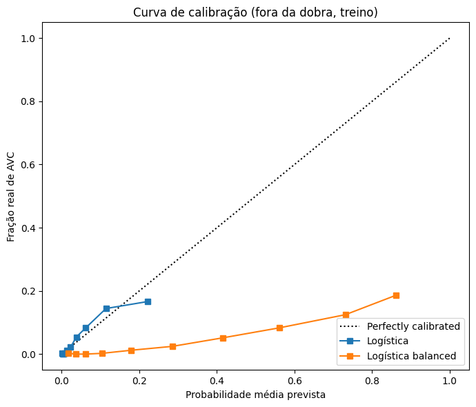

A logística comum está **bem calibrada** nas probabilidades baixas, onde fica a maioria dos pacientes: entre os que receberam ~10%, cerca de 10–15% tiveram AVC. A versão `balanced` **infla as probabilidades**: pacientes com 0,86 de "probabilidade" prevista têm só ~19% de AVC real. Por isso o `class_weight="balanced"` serve para classificar, mas suas probabilidades não podem ser lidas como risco.

### 6.5 Logística no teste (referência)

Com o limiar 0,07: **TP = 39, FN = 11, FP = 188, TN = 784.** Acurácia 0,805, precisão 0,172, revocação 0,780, F1 0,282, MCC 0,304. Esse resultado serve só de referência para o melhor modelo da seção 8.

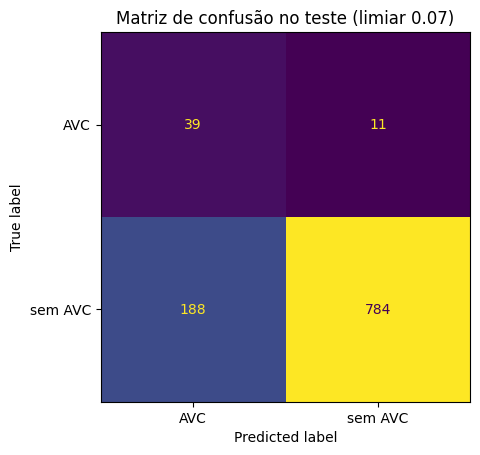

---

## 7. APS2 — Seleção e implementação dos modelos

### 7.1 Métrica de desempenho: average precision

A **AP** é a área sob a curva precisão-revocação. Foi escolhida por três motivos:
1. **Classe rara:** a acurácia é inútil (seção 6.2). A ROC-AUC também pode parecer otimista, porque a taxa de falsos positivos é dividida por 4 mil negativos e muda pouco mesmo com centenas de alarmes falsos (Saito & Rehmsmeier, 2015).
2. **Foco no AVC:** a AP só olha a classe positiva e resume, em todos os limiares, quantos AVCs são encontrados e quantos alertas são verdadeiros.
3. **Independência de limiar:** permite comparar modelos antes de escolher o corte. O corte é escolhido depois, pelo F2 (seção 8.1).

**Referência:** a AP de um modelo sem informação é igual à prevalência, **0,0487**. A ROC-AUC também é reportada.

### 7.2 Três modelos com o pipeline da APS1

| Modelo | Por que foi escolhido |
|---|---|
| **Dummy** (`strategy="prior"`) | Prevê sempre a prevalência. É o piso: qualquer modelo útil precisa superá-lo |
| **Logística com regularização L2** (`C=1`) | Rápida, convexa, interpretável (razões de chances) e um baseline forte para dados tabulares |
| **Random Forest** (300 árvores) | Média de árvores descorrelacionadas (Breiman, 2001). Captura não linearidades, como o risco que acelera após os 50 anos, e interações, sem precisar criá-las à mão |

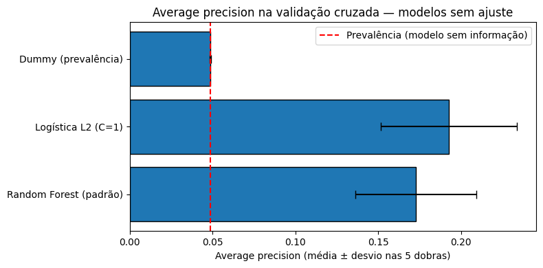

| Modelo | AP treino | AP validação | ROC-AUC validação |
|---|---|---|---|
| Dummy | 0,0487 | 0,0487 ± 0,0005 | 0,500 |
| Logística L2 (C=1) | 0,1957 | **0,1925 ± 0,0412** | **0,840** |
| Random Forest (padrão) | **1,0000** | 0,1727 ± 0,0366 | 0,813 |

- **Dummy:** AP igual à prevalência e ROC-AUC 0,5, exatamente o esperado de um modelo sem informação.
- **Logística:** AP de treino ≈ validação, então não sobreajusta. Ela tem 4 vezes a AP do Dummy.
- **Random Forest padrão:** **AP de treino 1,0 e validação 0,17.** Com `min_samples_leaf=1`, cada árvore cresce até isolar cada paciente e **decora o treino**. Com só 199 AVCs, essa memorização não generaliza. Sem ajuste, a floresta fica **abaixo** da logística.

### 7.3 Busca de hiperparâmetros — logística (`GridSearchCV`)

A grade completa tem 44 combinações (11 × 2 × 2), todas testadas, com a mesma métrica (AP) e as mesmas 5 dobras:

| Hiperparâmetro | Valores | Papel |
|---|---|---|
| `C` | 10⁻³ … 10² (11 valores em escala log) | Inverso da força da regularização. `C` menor significa mais penalidade |
| `penalty` | L1, L2 | L1 (Lasso) pode zerar coeficientes; L2 (Ridge) encolhe todos |
| `class_weight` | `None`, `"balanced"` | Dar mais peso aos AVCs no treino |

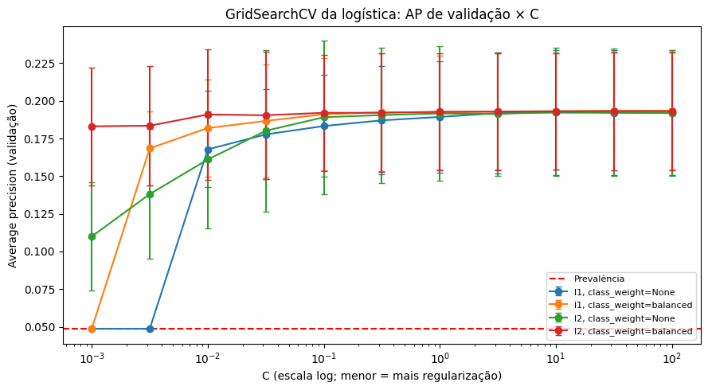

**Melhor configuração: `C = 100`, L1, `class_weight="balanced"`, AP = 0,1934.**

O gráfico mostra que:
- **Com `C` ≤ 0,003 e L1 sem pesos, a AP cai para 0,049.** A penalidade zera todos os coeficientes e o modelo vira o Dummy: é o **subajuste** por excesso de regularização.
- **De `C` ≈ 0,1 em diante, todas as curvas ficam planas em ~0,19.** Mais liberdade não ajuda, porque com 15 variáveis e 4 mil pacientes o modelo não tem capacidade de sobreajustar.
- **O `C = 100` escolhido está no extremo da grade**, mas a diferença para `C = 0,1` (~0,002) é **20 vezes menor que o desvio entre dobras** (~0,04). Na prática, a regularização **não muda o desempenho**: o ganho da busca sobre o modelo sem ajuste foi de 0,1925 para 0,1934. Pelo critério de simplicidade, um `C` em torno de 0,1 seria igualmente defensável e daria coeficientes mais estáveis (seção 9.1).
- O `class_weight="balanced"` ajuda nos `C` pequenos, onde compensa a penalidade, e não faz diferença nos grandes.

### 7.4 Busca de hiperparâmetros — Random Forest (`RandomizedSearchCV`)

A grade completa teria 240 combinações. Foram sorteadas **30** (150 ajustes), porque a busca aleatória costuma achar configurações tão boas quanto a busca completa com uma fração do custo (Bergstra & Bengio, 2012).

| Hiperparâmetro | Valores | Papel |
|---|---|---|
| `min_samples_leaf` | 1, 5, 10, 20, 50 | Tamanho mínimo da folha. É o principal freio contra a memorização vista em 7.2 |
| `max_depth` | None, 4, 8, 12 | Profundidade máxima das árvores |
| `max_features` | `"sqrt"`, 0,3, 0,5 | Fração de variáveis sorteadas em cada divisão. Menos variáveis deixam as árvores mais diferentes entre si |
| `class_weight` | `None`, `"balanced_subsample"` | Peso dos AVCs, recalculado em cada amostra bootstrap |
| `n_estimators` | 200, 400 | Mais árvores nunca pioram o resultado, só custam tempo |

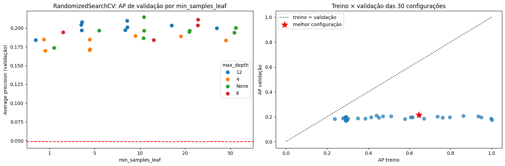

**Melhor configuração: 200 árvores, `min_samples_leaf=10`, `max_features=0.5`, `max_depth=None`, `class_weight=None`, AP = 0,2144 ± 0,0482.**

- **Painel da direita:** a AP de treino das 30 configurações vai de 0,24 a 1,0, mas a AP de validação fica entre 0,17 e 0,21 em todas. **Quanto mais o modelo decora o treino, mais longe ele fica da diagonal**, sem ganho na validação.
- A melhor configuração usa folhas de pelo menos 10 pacientes, ou seja, troca memorização por regras que valem para grupos.
- **Ganho da busca:** de 0,1727 para **0,2144** (+24%). Na floresta, o ajuste de hiperparâmetros importa muito mais que na logística.

### 7.5 Comparação após o ajuste

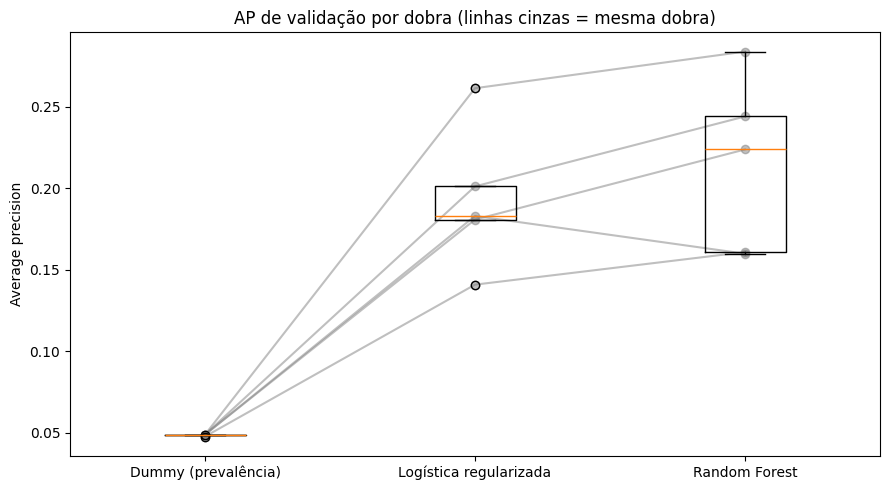

| Modelo | AP validação |
|---|---|
| Dummy | 0,0487 ± 0,0005 |
| Logística regularizada | 0,1934 ± 0,0392 |
| **Random Forest** | **0,2144 ± 0,0482** |

**A Random Forest foi escolhida como melhor modelo até aqui.** A diferença (0,021) é menor que o desvio entre as dobras, então a vantagem sobre a logística é **modesta**.

### 7.6 Mudança no pipeline

**Proposta:** duas alterações no tratamento das numéricas.

1. **Indicador de `bmi` ausente (`MissingIndicator`).** Na APS1, o `bmi` ausente foi preenchido com a mediana, o que apaga a informação de que ele estava faltando. A tabela abaixo mostra que **a ausência carrega muito sinal**:

   | `bmi` | Pacientes (treino) | Taxa de AVC |
   |---|---|---|
   | Registrado | 3.918 | 4,1% |
   | **Ausente** | **170** | **21,8%** |

   No dataset completo: 40 AVCs em 201 pacientes sem `bmi` (19,9%), contra 4,3% nos demais. **Um paciente sem `bmi` tem 5 vezes a taxa de AVC.**

2. **`log1p` em `avg_glucose_level` e `bmi` (`FunctionTransformer`).** A glicose é assimétrica e tem dois grupos (seção 2.2). O log comprime os valores extremos, o que importa para modelos lineares. Em árvores, transformações monotônicas não mudam as divisões possíveis, então **na Random Forest só o indicador pode fazer diferença**.

**Avaliação:** mesma métrica (AP), mesmas 5 dobras e **uma nova busca de hiperparâmetros** (outro `RandomizedSearchCV` com 30 configurações), já que a melhor configuração pode mudar com o novo pipeline.

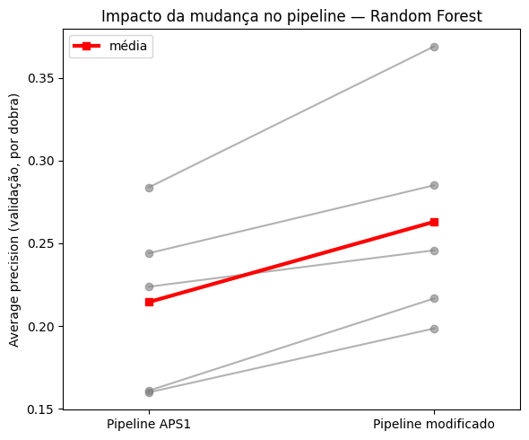

| Pipeline | AP validação | Melhor configuração |
|---|---|---|
| APS1 | 0,2144 ± 0,0482 | 200 árvores, `min_samples_leaf=10`, `max_features=0.5`, sem limite de profundidade |
| **Modificado** | **0,2631 ± 0,0606** | 200 árvores, `max_depth=4`, `max_features="sqrt"`, `min_samples_leaf=1` |

- **Ganho: +0,049 de AP (+23%), com melhora em 5 de 5 dobras.** Como a comparação é pareada, nas mesmas dobras, a melhora consistente indica que não é ruído.
- A busca escolheu **árvores rasas (profundidade 4)**: com o indicador, poucas divisões (idade, glicose, hipertensão e `bmi` ausente) já capturam o sinal.
- **O pipeline modificado foi adotado. Melhor modelo final: Random Forest (pipeline modificado).**

> ⚠️ **Ressalva importante sobre a mudança.** A ausência do `bmi` provavelmente é um **artefato da coleta**, não um fator de risco. Por exemplo, pacientes internados após o AVC podem não ter sido pesados. Nesse caso, a ausência é uma **consequência** do AVC, e o modelo estaria aproveitando um vazamento de informação sobre o desfecho. Num uso real, em que o modelo prevê o risco **antes** do evento, esse sinal não existiria e o ganho de 0,049 desapareceria. Sem documentação de como os dados foram coletados (seção 10.2), não dá para confirmar nenhuma das duas hipóteses. Os resultados com o pipeline da APS1 (AP 0,214) devem ser vistos como uma estimativa mais conservadora.

### 7.7 Curva de aprendizado do melhor modelo

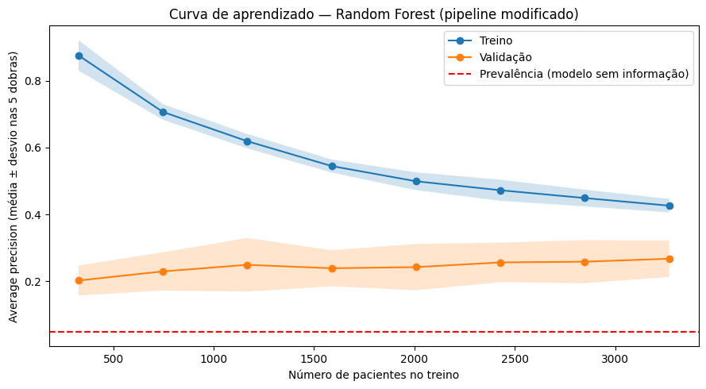

| Tamanho do treino | AP treino | AP validação |
|---|---|---|
| ~330 pacientes | 0,87 | 0,20 |
| ~1.600 | 0,55 | 0,24 |
| ~3.270 (tudo) | **0,43** | **0,27** |

**Diagnóstico: variância (sobreajuste moderado).**
- A AP de treino cai à medida que o treino cresce: com poucos pacientes o modelo decora, e com muitos isso fica impossível.
- A AP de validação **sobe devagar** (0,20 → 0,27) e não estabilizou.
- Ao final, sobra uma distância de **0,16** entre as duas curvas.

**Consequência prática:** coletar mais dados, principalmente mais casos de AVC, deve melhorar o modelo, mas devagar. A curva de validação ainda sobe, embora pouco. A faixa sombreada larga na validação (±0,05) reflete os ~40 AVCs por dobra: a estimativa da AP é ruidosa.

---

## 8. APS2 — Avaliação do melhor modelo no teste

### 8.1 Escolha do limiar

A Random Forest prevê probabilidades. As métricas pedidas (accuracy, precision, recall e F1) precisam de um corte. O limiar foi escolhido **só com o treino**: probabilidades fora da dobra e o valor que **maximiza o F2** (seção 6.3). **Limiar escolhido: 0,08.**

### 8.2 Métricas no teste

| Limiar | Accuracy | Precision | Recall | F1-score | F2 |
|---|---|---|---|---|---|
| **0,08 (F2)** | 0,8151 | **0,1826** | **0,8000** | **0,2974** | **0,4773** |
| 0,50 (padrão) | 0,9511 | 0,0000 | 0,0000 | 0,0000 | 0,0000 |

| Métrica independente de limiar | Valor |
|---|---|
| **ROC-AUC** | **0,8442** |
| Average precision | 0,2302 (prevalência 0,0489 → **4,7 vezes** o acaso) |

**Leitura das métricas:**
- **Recall 0,80:** o modelo encontra 4 de cada 5 AVCs. É a métrica priorizada pela premissa de custo.
- **Precision 0,18:** cerca de 1 em cada 5,5 alertas é um AVC real. Parece baixo, mas a taxa de base é 1 em 20, então um alerta do modelo tem **3,7 vezes** mais chance de ser AVC que um paciente qualquer.
- **Accuracy 0,815:** mais baixa que a do limiar 0,5 (0,951), que não detecta **nenhum** AVC. É o paradoxo da acurácia de novo: o limiar padrão daria a maior acurácia e o modelo inútil.
- **F1 0,30:** é baixo porque o F1 pesa precisão e revocação igualmente, e a precisão é limitada pela prevalência.
- **AP no teste (0,230) × validação (0,263):** a diferença está dentro do desvio entre dobras (±0,06) e é coerente com o leve otimismo de escolher o melhor entre vários modelos na validação.

### 8.3 Matriz de confusão

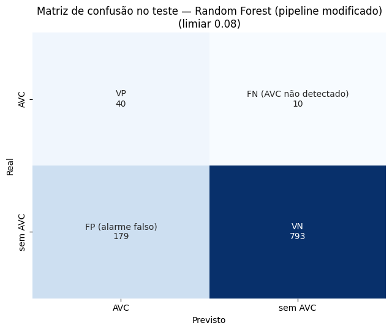

|  | Previsto AVC | Previsto sem AVC |
|---|---|---|
| **Real AVC** | **VP = 40** | **FN = 10** (AVCs não detectados) |
| **Real sem AVC** | **FP = 179** (alarmes falsos) | VN = 793 |

- **Falsos negativos (10):** são os erros mais graves. Esses pacientes tiveram AVC e não seriam sinalizados. Na seção 9.3, o SHAP mostra que o FN mais extremo é uma criança de 14 anos sem comorbidades, um perfil que as variáveis disponíveis não conseguem identificar.
- **Falsos positivos (179):** 18% dos pacientes sem AVC seriam sinalizados. É o custo de buscar recall alto numa classe rara. Em triagem, isso significaria encaminhar esses pacientes para avaliação preventiva.
- **Comparação com a logística no teste (seção 6.5):** a RF encontrou 40 AVCs com 179 alarmes falsos; a logística, 39 com 188. **No teste, a vantagem da RF é pequena**, coerente com a diferença modesta na validação.

### 8.4 Curva ROC e curva precisão-revocação

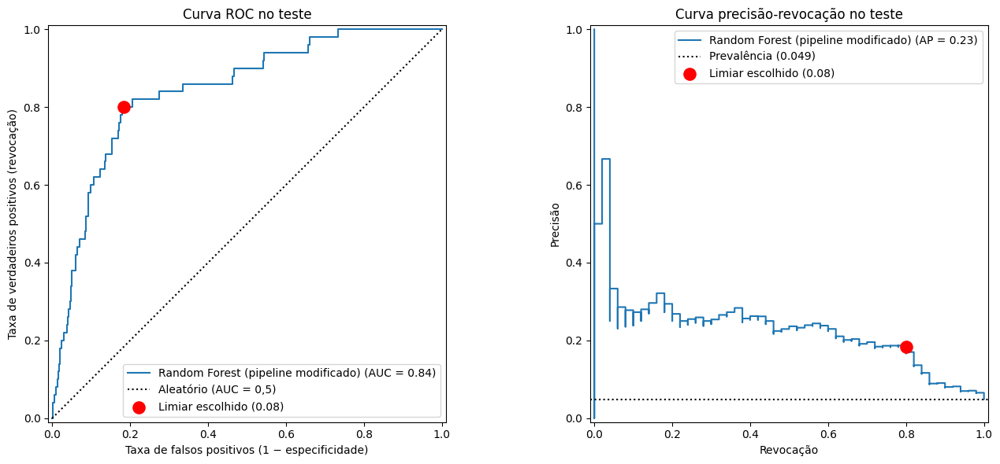

- **ROC-AUC = 0,844:** sorteando ao acaso um paciente com AVC e outro sem, o modelo dá risco maior ao paciente com AVC em 84% das vezes. A diagonal pontilhada (0,5) é o acaso. O ponto vermelho é o limiar 0,08 (taxa de falsos positivos 0,18, revocação 0,80).
- **Curva precisão-revocação:** fica bem abaixo da ROC, e a linha da prevalência (0,049) é a referência de acaso. Ela mostra o custo real da classe rara: para passar de 80% de revocação, a precisão cai para perto da prevalência. A ROC sozinha, com 0,84, daria uma impressão otimista demais. Esse é o motivo de a AP ter sido a métrica de seleção.

---

## 9. APS2 — Interpretação e explicabilidade

### 9.1 Modelo linear: 3 coeficientes de maior magnitude

Modelo: a melhor logística do `GridSearchCV` (`C = 100`, L1, `balanced`). As numéricas estão padronizadas, então os coeficientes são comparáveis entre si.

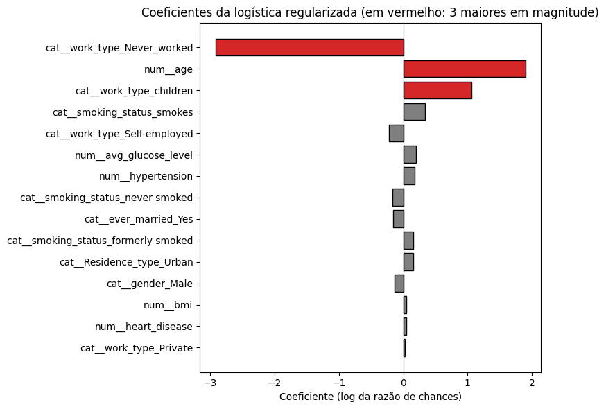

| # | Variável | Coeficiente | Razão de chances | Leitura |
|---|---|---|---|---|
| 1 | `work_type_Never_worked` | −2,920 | ×0,05 | "Nunca ter trabalhado" reduziria a chance em 95% |
| 2 | `age` (+1 dp ≈ 22,6 anos) | +1,898 | ×6,67 | 22,6 anos a mais multiplicam a chance por 6,7 |
| 3 | `work_type_children` | +1,061 | ×2,89 | Ser "criança" quase triplicaria a chance |

**Análise:** só a **idade** tem uma interpretação válida. As outras duas são **artefatos estatísticos**:
- **`Never_worked`:** são 22 pacientes e **nenhum AVC** (seção 5.3). Sem nenhum evento, o coeficiente que maximiza a verossimilhança tende a −∞. Com `C = 100`, quase não há penalidade para segurá-lo. O valor −2,92 reflete o tamanho da categoria e a regularização fraca, **não um efeito protetor**.
- **`children`:** crianças têm só 0,3% de AVC (2 em 687). O coeficiente positivo aparece porque a idade já está no modelo: entre crianças, idade e `work_type` estão totalmente sobrepostas, e o coeficiente só corrige a previsão da idade para essa faixa. Ele é instável (baseado em 2 casos) e não significa que ser criança aumente o risco.
- **`age`:** é o efeito dominante e coerente com a literatura (a incidência de AVC cresce com a idade) e com a EDA (idade média de 67,7 anos nos casos contra 42,0).

**Lição:** os coeficientes de maior magnitude não são necessariamente as variáveis mais importantes. Com `C` menor (mais regularização), os coeficientes das categorias raras seriam encolhidos, e as variáveis clínicas (glicose, hipertensão) subiriam no ranking, sem perda de AP (seção 7.3).

### 9.2 Modelo ensemble: 3 features mais importantes

Modelo: a melhor Random Forest da seção 7.4 (pipeline da APS1). Foram usadas duas medidas.

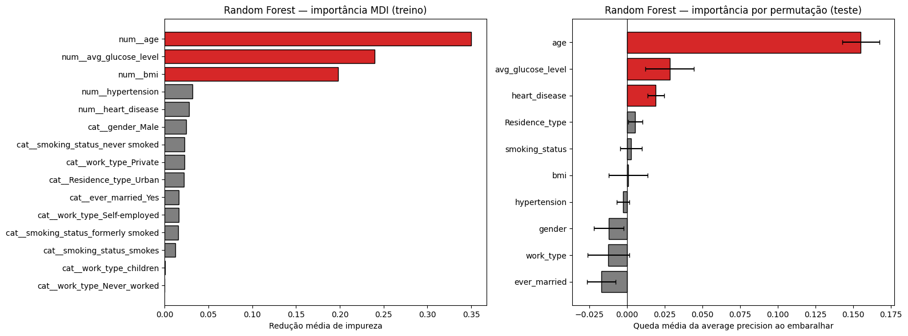

| # | MDI (impureza, no treino) | Permutação (queda da AP, no teste) |
|---|---|---|
| 1 | `age` | `age` |
| 2 | `avg_glucose_level` | `avg_glucose_level` |
| 3 | `bmi` | `heart_disease` |

**Análise:**
- **`age` e `avg_glucose_level` lideram nas duas medidas.** São as importâncias robustas, coerentes com a correlação (seção 2.5) e com fatores de risco clínicos conhecidos: o envelhecimento e a hiperglicemia, ligada ao diabetes, são fatores de risco estabelecidos para AVC.
- **O `bmi` aparece em 3º na MDI, mas sai do top 3 na permutação.** A MDI é calculada no treino e **favorece variáveis contínuas com muitos valores distintos** (418 no `bmi`), porque elas oferecem muitos pontos de corte e a árvore os usa para decorar. A permutação, medida em dados novos, mostra que embaralhar o `bmi` quase não piora a AP. O ganho dele era memorização. Isso é coerente com a correlação fraca do `bmi` com o AVC (0,044).
- **`heart_disease`** entra no top 3 da permutação. É binária, então a MDI a subestima (só oferece uma divisão possível), mas ela carrega sinal real.
- A importância mostra **quanto** o modelo depende de cada variável, não **em que direção**. A direção aparece no SHAP.

### 9.3 SHAP no melhor modelo

Modelo: Random Forest com o pipeline modificado. Com o `TreeExplainer`, os valores ficam em **unidades de probabilidade**: a previsão de cada paciente é igual ao valor base (a probabilidade média) mais a soma das contribuições de cada variável (Lundberg & Lee, 2017).

#### Importância global

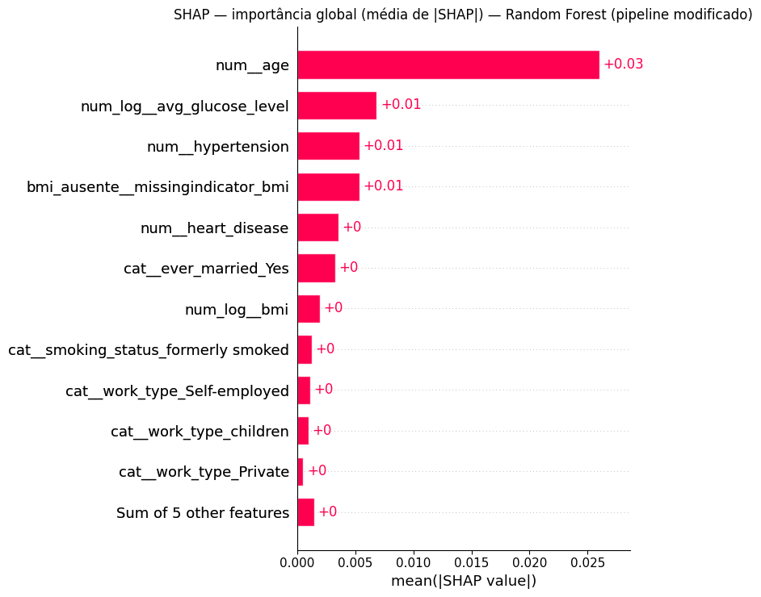
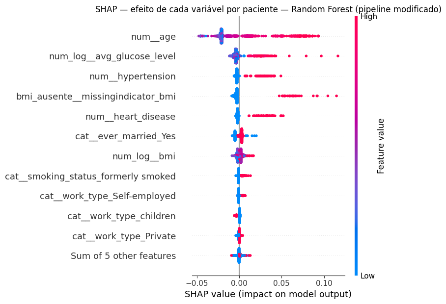

Ordem de importância (média de |SHAP|): **`age` > `avg_glucose_level` > `hypertension` > `bmi` ausente > `heart_disease`** > `ever_married` > `bmi` > ex-fumante > …

Leitura do beeswarm, em que cada ponto é um paciente, a cor é o valor da variável (vermelho = alto) e a posição é o efeito no risco:
- **`age`:** idades altas (vermelho) empurram o risco para cima em até +0,09; idades baixas (azul) reduzem levemente. É a relação monotônica esperada, e é também a variável com maior espalhamento.
- **Glicose (log):** a maioria dos pacientes tem efeito ≈ 0, mas glicose alta acrescenta até +0,12, o maior efeito individual do gráfico. O efeito é **não linear**: só os valores altos importam, o que a Random Forest captura sem precisar de termos polinomiais.
- **`hypertension` e `heart_disease`:** quando presentes (vermelho), somam entre +0,02 e +0,05. Quando ausentes, quase não mudam nada.
- **Indicador de `bmi` ausente:** quando o `bmi` falta (vermelho), o risco sobe entre +0,05 e +0,11. É a variável criada na seção 7.6, e o tamanho do efeito reforça a ressalva feita lá.
- **`ever_married`:** efeito pequeno, provavelmente herdado da idade, já que pessoas casadas são em média mais velhas.

#### Três predições individuais

Escolhemos três pacientes do teste que representam situações diferentes: o acerto mais confiante, o erro mais grave e o alarme falso mais forte.

**Caso 1 — Verdadeiro positivo (o paciente com AVC de maior risco previsto)**

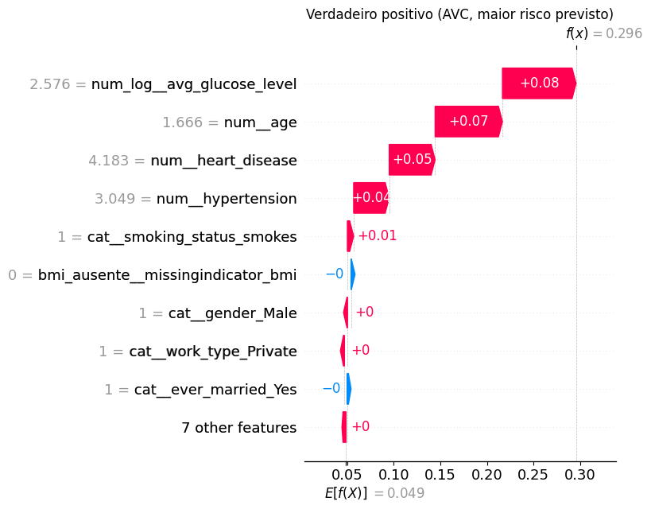

| Perfil | Valor |
|---|---|
| Sexo / idade | Masculino, **81 anos** |
| Hipertensão / doença cardíaca | **Sim / Sim** |
| Glicose média | **250,9 mg/dL** |
| `bmi` / tabagismo | 28,1 / fumante |
| **Probabilidade prevista** | **0,296** (6 vezes a taxa de base) |

Features que mais contribuíram: **glicose (+0,079), idade (+0,072), doença cardíaca (+0,049)**. É o perfil clássico de alto risco, com todos os fatores somando na mesma direção. Mesmo assim, a probabilidade fica em 0,30, e não perto de 1. As variáveis disponíveis não bastam para ter certeza de um AVC.

**Caso 2 — Falso negativo (o paciente com AVC de menor risco previsto)**

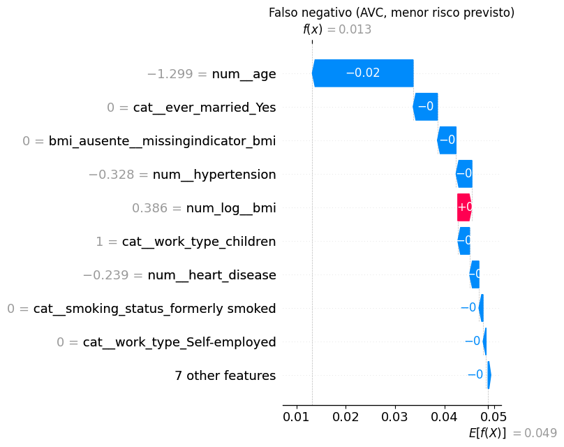

| Perfil | Valor |
|---|---|
| Sexo / idade | Feminino, **14 anos** |
| Hipertensão / doença cardíaca | Não / Não |
| Glicose média | 57,9 mg/dL (normal) |
| `bmi` / tabagismo | 30,9 / Unknown |
| Tipo de trabalho | children |
| **Probabilidade prevista** | **0,013** |

Features que mais contribuíram: **idade (−0,020), `ever_married = Yes` ausente (−0,005), `bmi` registrado (−0,004)**, todas **reduzindo** o risco. Esse é o **erro mais grave** do modelo: uma adolescente sem nenhum fator de risco registrado. AVCs em jovens costumam ter causas que **não estão no dataset**, como malformações vasculares, doenças cardíacas congênitas ou distúrbios de coagulação. Nenhum modelo treinado com essas variáveis conseguiria sinalizá-la. É uma limitação dos **dados**, não do algoritmo. Ela é um dos 8 AVCs com menos de 40 anos no dataset (3%).

**Caso 3 — Falso positivo (o paciente sem AVC de maior risco previsto)**

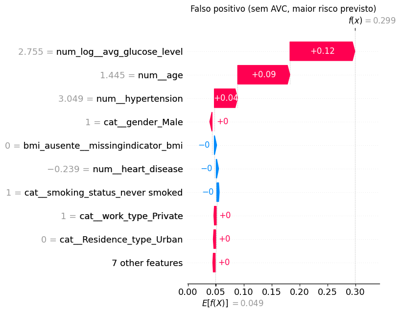

| Perfil | Valor |
|---|---|
| Sexo / idade | Masculino, **76 anos** |
| Hipertensão / doença cardíaca | **Sim** / Não |
| Glicose média | **267,6 mg/dL** |
| `bmi` / tabagismo | 30,5 / nunca fumou |
| **Probabilidade prevista** | **0,299** |

Features que mais contribuíram: **glicose (+0,116), idade (+0,094), hipertensão (+0,042)**. O perfil é quase idêntico ao do Caso 1, e a probabilidade também (0,299 × 0,296). **Para o modelo, os dois pacientes são indistinguíveis.** Esse "erro" faz sentido: é um paciente de altíssimo risco que não teve AVC **no período registrado**. Clinicamente, é exatamente o tipo de paciente que um sistema de triagem deveria sinalizar para acompanhamento preventivo.

---

## 10. APS2 — Discussão crítica

### 10.1 Limitações do melhor modelo

**1. Associação não é causa, e as explicações herdam essa limitação.**
- O SHAP e as importâncias mostram **como o modelo usa** cada variável, não o efeito causal dela sobre o AVC.
- `ever_married` aparece com efeito positivo só por estar correlacionada com a idade. O mesmo vale para os coeficientes de `children` e `Never_worked` (seção 9.1).
- Quando variáveis são correlacionadas, o crédito é dividido entre elas de forma que depende do algoritmo. Uma explicação SHAP é uma **estimativa a ser verificada**, não uma justificativa clínica (Lundberg & Lee, 2017; Molnar, 2022).
- Usar o modelo para recomendar intervenções ("reduzir X diminui o risco") seria um erro: para isso seria preciso um desenho causal, não um modelo preditivo.

**2. Poucos eventos e estimativas instáveis.**
- O treino tem **199 AVCs** e o teste, **50**. Em modelos de predição clínica, o número de eventos por parâmetro determina a estabilidade do modelo (Peduzzi et al., 1996; Riley et al., 2020).
- A instabilidade aparece em todo o trabalho:
  - desvio de ±0,04 a ±0,06 na AP entre dobras, maior que várias das diferenças entre modelos;
  - coeficientes que divergem em categorias sem eventos;
  - no teste, cada AVC detectado vale 2 pontos de recall.
- A vantagem da Random Forest sobre a logística (40 × 39 AVCs detectados no teste) **não é estatisticamente distinguível**. Os números deste relatório não devem ser lidos como precisos na segunda casa decimal.

### 10.2 Limitações dos dados

**1. Origem desconhecida, sem documentação, e a possibilidade de vazamento no `bmi` ausente.**
- O dataset não informa a instituição de origem, o país, o período, o critério de inclusão nem como o AVC foi diagnosticado.
- Sem uma documentação no formato de *datasheet* (Gebru et al., 2021), não dá para saber **a quem o modelo se aplica**, se há viés de seleção ou se os pacientes com e sem AVC foram registrados da mesma forma.
- O caso do `bmi` ausente mostra o risco concreto disso. A taxa de AVC é 5 vezes maior quando o `bmi` falta (seção 7.6), o que sugere que a forma de coleta foi diferente para os casos. Se for isso, o melhor modelo explora um artefato de registro.
- Também não há uma segunda base para **validação externa**, sem a qual o desempenho em outra população é desconhecido.

**2. Dados transversais e fatores de risco ausentes.**
- Não há informação temporal: não se sabe se a hipertensão, a glicose ou o tabagismo foram medidos **antes ou depois** do AVC. Isso permite **causalidade reversa**. Por exemplo, a taxa maior entre ex-fumantes (7,8%) do que entre fumantes (5,4%) pode refletir pacientes que pararam de fumar **depois** do evento.
- Faltam fatores de risco estabelecidos para AVC, como **fibrilação atrial, pressão arterial medida (e não só o diagnóstico de hipertensão), colesterol, uso de anti-hipertensivos, diabetes diagnosticado e histórico familiar**. Vários deles fazem parte de escores clínicos consolidados, como o perfil de risco de Framingham (Wolf et al., 1991).
- `smoking_status = "Unknown"` cobre **30%** dos pacientes.
- O falso negativo da seção 9.3 (14 anos, sem fatores) mostra o efeito prático: AVCs com causas fora dessas variáveis são invisíveis para qualquer modelo treinado com elas.

### 10.3 Ações para operacionalização e manutenção

**1. Monitoramento contínuo e recalibração periódica.**
- Em produção, a população atendida muda com o tempo: perfil etário, prevalência de AVC, equipamentos e protocolos de medição. Isso degrada o modelo silenciosamente, sem nenhum erro aparente no sistema (Sculley et al., 2015).
- O que monitorar:
  - **a distribuição das variáveis de entrada**, por exemplo a fração de `bmi` ausente, que é crítica dada a seção 7.6;
  - **a distribuição das probabilidades previstas**;
  - **AP, recall e calibração**, assim que os desfechos reais forem conhecidos.
- A calibração é o ponto que mais se degrada quando a prevalência muda (Van Calster et al., 2019). O modelo deve ser recalibrado ou retreinado quando o monitoramento indicar desvio, e o limiar reavaliado junto.

**2. Uso como apoio à decisão, com documentação e governança.**
- O modelo deve entrar no fluxo clínico como **ferramenta de triagem** para acompanhamento preventivo, com decisão final do profissional de saúde, **nunca como diagnóstico automático**.
- O limiar (hoje 0,08) deve ser definido com a equipe clínica, conforme a capacidade de absorver alarmes falsos. Com o limiar atual, seriam ~18% dos pacientes sem AVC sinalizados.
- O modelo deve ser publicado com um ***model card*** (Mitchell et al., 2019) que registre:
  - os dados de treino e suas limitações (seção 10.2);
  - as métricas **por subgrupo** (sexo, faixa etária), para detectar desempenho desigual;
  - o uso pretendido e o não pretendido.
- Por tratar de dados de saúde, que são dados pessoais sensíveis, o uso precisa respeitar a **LGPD** (Lei 13.709/2018), incluindo o direito do titular de pedir revisão de decisões tomadas só com base em tratamento automatizado (art. 20). Isso reforça a necessidade de um humano na decisão final.

---

## 11. Reprodutibilidade

| Item | Valor |
|---|---|
| Semente aleatória | `random_state=42` em todos os splits, buscas e modelos |
| Divisão | 80/20 estratificada → 4.088 treino / 1.022 teste |
| Validação | `StratifiedKFold(n_splits=5, shuffle=True, random_state=42)` |
| Métrica de seleção | `average_precision` |
| Limiar final | 0,08 (maior F2 fora da dobra no treino) |
| Melhor modelo | `RandomForestClassifier(n_estimators=200, max_depth=4, max_features="sqrt", min_samples_leaf=1)` com o pipeline modificado |

**Como rodar:** abrir `stroke_prediction.ipynb` (Colab ou Jupyter) e executar **todas as células em ordem**. A primeira célula de código baixa o dataset com `kagglehub`, e as demais dependem do `dataset` carregado nela. A busca da Random Forest (150 ajustes, repetida na seção 7.6) leva alguns minutos. O `shap` é instalado no próprio notebook (`%pip install shap`).

**Avisos esperados:** o scikit-learn 1.8 emite `FutureWarning` sobre o parâmetro `penalty` da `LogisticRegression`, que será substituído por `l1_ratio` em versões futuras. O aviso não afeta os resultados.

---

## 12. Referências

- Bergstra, J.; Bengio, Y. (2012). Random search for hyper-parameter optimization. *Journal of Machine Learning Research*, 13, 281–305.
- Brasil. Lei nº 13.709, de 14 de agosto de 2018. Lei Geral de Proteção de Dados Pessoais (LGPD).
- Breiman, L. (2001). Random forests. *Machine Learning*, 45(1), 5–32. https://doi.org/10.1023/A:1010933404324
- Chicco, D.; Jurman, G. (2020). The advantages of the Matthews correlation coefficient (MCC) over F1 score and accuracy in binary classification evaluation. *BMC Genomics*, 21, 6. https://doi.org/10.1186/s12864-019-6413-7
- fedesoriano (2021). *Stroke Prediction Dataset*. Kaggle. https://www.kaggle.com/datasets/fedesoriano/stroke-prediction-dataset
- Gebru, T. et al. (2021). Datasheets for datasets. *Communications of the ACM*, 64(12), 86–92. https://doi.org/10.1145/3458723
- Lundberg, S. M.; Lee, S.-I. (2017). A unified approach to interpreting model predictions. *Advances in Neural Information Processing Systems*, 30.
- Mitchell, M. et al. (2019). Model cards for model reporting. *Proceedings of the Conference on Fairness, Accountability, and Transparency (FAT\* '19)*, 220–229. https://doi.org/10.1145/3287560.3287596
- Molnar, C. (2022). *Interpretable Machine Learning* (2ª ed.). https://christophm.github.io/interpretable-ml-book/
- Pedregosa, F. et al. (2011). Scikit-learn: Machine learning in Python. *Journal of Machine Learning Research*, 12, 2825–2830.
- Peduzzi, P. et al. (1996). A simulation study of the number of events per variable in logistic regression analysis. *Journal of Clinical Epidemiology*, 49(12), 1373–1379. https://doi.org/10.1016/S0895-4356(96)00236-3
- Riley, R. D. et al. (2020). Calculating the sample size required for developing a clinical prediction model. *BMJ*, 368, m441. https://doi.org/10.1136/bmj.m441
- Saito, T.; Rehmsmeier, M. (2015). The precision-recall plot is more informative than the ROC plot when evaluating binary classifiers on imbalanced datasets. *PLoS ONE*, 10(3), e0118432. https://doi.org/10.1371/journal.pone.0118432
- Sculley, D. et al. (2015). Hidden technical debt in machine learning systems. *Advances in Neural Information Processing Systems*, 28.
- Van Calster, B. et al. (2019). Calibration: the Achilles heel of predictive analytics. *BMC Medicine*, 17, 230. https://doi.org/10.1186/s12916-019-1466-7
- Wolf, P. A. et al. (1991). Probability of stroke: a risk profile from the Framingham Study. *Stroke*, 22(3), 312–318. https://doi.org/10.1161/01.STR.22.3.312
